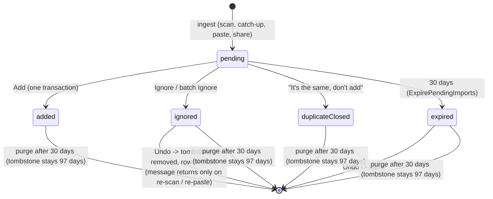

# Phase 1 Data Model: Bank SMS Transaction Import

**Feature**: [spec.md](spec.md) · **Research**: [research.md](research.md) (authoritative for technical choices) · **Date**: 2026-10-06 · **Schema**: Drift 12 -> **13**

Derived from the spec's Key Entities and Data Model Impact sections and verified against `lib/core/database/app_database.dart` (epoch-millisecond `int` timestamps and date-only days, lower-case `text` enums stored through a `dbValue` extension, `idempotencyKey` text unique, `Set<Column> get primaryKey => {id}`), `lib/core/sync/sync_entity_type.dart` (`localOnlyTables`) and `lib/core/database/data_wipe.dart`. All money is integer minor units plus an ISO 4217 code (`Money`); there is no float anywhere in this feature.

Conventions used below:

- "Local-only" = listed in `localOnlyTables`, never in the sync outbox, never pulled, never exported.
- Enum columns store the lower-camel/snake string shown in the **DB value** column; Dart enums are mapped by an explicit `dbValue` getter and a total `fromDb` that returns a safe default, as for `TransactionSource`.
- Paths: domain entities under `lib/features/sms_import/domain/entities/`, tables in `lib/core/database/app_database.dart` (all tables of this repo live there), migration in `lib/core/database/migrations/v13_sms_import.dart`.

---

## 1. Classification summary

| Concern | Table / type | Local-only or synced | Contains raw text? |
|---|---|---|---|
| Staging suggestion | `pending_sms_imports` | local-only | Only `raw_blob`, masked then AES-GCM sealed, only while `status = pending` |
| Hashed memory of decisions | `sms_import_tombstones` | local-only | No (keyed hashes only) |
| Muted senders | `sms_sender_mutes` | local-only | No (a sender ID, public) |
| Learned merchant -> category | `sms_merchant_category_mappings` | local-only | Normalized merchant text only (digit and punctuation free), no message body |
| Feature settings, cursor, counters | `sms_import_settings` (singleton) | local-only | No |
| Provenance on saved records | `money_transactions.import_source`, `finance_entries.import_source` | **synced** (new optional wire field, migration 027) | No |

Five new names are added to `localOnlyTables`: `pending_sms_imports`, `sms_import_tombstones`, `sms_sender_mutes`, `sms_merchant_category_mappings`, `sms_import_settings`. `table_classification_guard_test.dart` (exact set at `:157`) is updated, and `data_wipe_test.dart` (which iterates `allTables`) must pass with them.

---

## 2. Value objects and enums (domain)

### 2.1 `SmsSource` (where a message entered the pipeline)

| Dart | DB value | Meaning |
|---|---|---|
| `inboxScan` | `scan` | User-initiated inbox scan (FR-006) |
| `catchUpScan` | `catchup` | Automatic foreground catch-up (FR-013) |
| `paste` | `paste` | Paste screen, clipboard or text field (FR-015) |
| `share` | `share` | Android `ACTION_SEND text/plain` (FR-016) |

Derived: `bool get hasSender` (scan and catch-up only), `bool get hasReceivedAt`, `bool get capsConfidenceAtMedium` (paste and share, FR-020). Immutable after creation. Research names the column `origin`; the Dart type is `SmsSource` per this plan.

### 2.2 `SmsImportStatus`

| Dart | DB value | Terminal | Raw text | Visible in Undo list |
|---|---|---|---|---|
| `pending` | `pending` | no | sealed blob present (if readable) | n/a |
| `added` | `added` | yes | purged | no |
| `ignored` | `ignored` | yes | purged | yes, 30 days |
| `duplicateClosed` | `duplicate` | yes | purged | no (FR-061, Vocabulary box) |
| `expired` | `expired` | yes | purged | yes, 30 days |

### 2.3 `SmsKind` (what the message describes; drives the mapping table)

`cardPurchase`, `atmWithdrawal`, `cardOrLoanSettlement` (credit-card payment, installment debit or conversion notice, own-card or loan settlement), `billPayment`, `fee`, `salary`, `otherDeposit`, `transferOut`, `transferIn`, `refund`, `authorizationReversal` (FR-024b: a cancelled authorization; Ignore suggested), `ownAccountTransfer`, `unknown`. InstaPay is a channel: `bankId = 'instapay'` with `transferOut` or `transferIn`. DB value = the Dart name, snake-cased (`card_purchase`, ...). `unknown` is allowed only on a pending item whose direction is known (it then has no default suggestion beyond FR-033).

### 2.4 `SmsDirection`

`debit` | `credit` | `unknown`. `unknown` means "amount present, nature not determinable" (FR-033): the item is pending but incomplete.

### 2.5 `SuggestedRecordType` (the suggestion, not a decision)

| Dart | DB value | Maps to |
|---|---|---|
| `expense` | `expense` | `FinanceEntry` type expense |
| `income` | `income` | `FinanceEntry` type income |
| `given` | `given` | `MoneyTransaction` direction given, kind `initialExchange` |
| `received` | `received` | `MoneyTransaction` direction received, kind `initialExchange` |
| `ignore` | `ignore` | Ignore is the suggested action (ATM, refund, own-account, card settlement) |
| `unset` | `unset` | No default (non-salary deposit, unknown direction); user must choose Income or Ignore |

Repayment and occasion contribution are never values (NG8, FR-048). The user's chosen type during review is **draft state** in the review cubit, never persisted on the row (FR-047: leaving without Add leaves the item unchanged).

### 2.6 `ParseConfidence`, `FieldConfidence`, `OverallConfidence`

- **Promoted, not copied** (research Decision 8): `FieldConfidence`, `FieldConfidenceKind`, `FieldConfidenceLevel` move from `lib/features/ocr/domain/entities/field_confidence.dart` to `lib/core/confidence/field_confidence.dart` (`git mv`, import updates in the 8 lib and 10 test importers, tests move with it, no behavior change). `ConfidenceIndicator` moves from `lib/features/ocr/presentation/widgets/confidence_indicator.dart` to `lib/core/design_system/confidence_indicator.dart`. The type invariant is unchanged: `inferred` always has level `none`.
- `OverallConfidence` enum: `low | medium | high` (never `none`).
- `ParseConfidence` (immutable value object):

| Field | Type | Rule |
|---|---|---|
| `fields` | `Map<SmsField, FieldConfidence>` | One entry per extracted field; absent key = field not present |
| `overall` | `OverallConfidence` | Output of `overallConfidence(...)` ([parser-contract.md](contracts/parser-contract.md) section 6); never stored as a number or percentage (FR-040) |

`SmsField` enum: `amount, currency, direction, date, time, merchant, counterparty, cardLast4, reference, kind`. Required fields (FR-043a) for confidence purposes: `amount, currency, direction, date`.

Persistence form (`confidence_json`): `{"overall":"high","fields":{"amount":"read:high","date":"inferred","currency":"inferred"}}` (the same `read:<level>` / `inferred` tokens as the corpus fixtures).

### 2.7 `DuplicateTier` and findings

```
enum DuplicateTier { none, exact, probable, legitimatelySimilar }
enum ExactBasis   { fingerprint, bankReferenceAmountDirection }
enum ProbableBasis{ savedRecord, pendingPair }
```

`DuplicateFinding` (not persisted): `tier`, `exactBasis?`, `probableBasis?`, `matchedPendingId?`, `matchedRecord?` (`DuplicateRecordRef`: `id`, `recordType` = `moneyTransaction | financeEntry`, `direction`/`type`, `amount`, `date`, `importProvenance?`, plus display fields loaded on demand for the side-by-side card). Evaluation order is fixed by FR-059b.

### 2.8 `ImportProvenance` (new, `lib/core/provenance/import_provenance.dart`)

Shared by `transactions` and `finance`, therefore in `core` (constitution II).

| Dart | Wire / DB string | Meaning |
|---|---|---|
| `sms` | `'sms'` | Saved from a bank-message import |
| `unknown` | any other non-null string | A value written by a future client; kept and round-tripped, never interpreted |

`null` = not imported (FR-057). Helpers: `ImportProvenance.fromWire(String)`, `String get wire` (for `unknown`, the original string is preserved by carrying it in a private `raw` field so the round trip is lossless; equality uses `raw`). Not a new value of `TransactionSource` (FR-086).

### 2.9 Other small types

| Type | Shape | Notes |
|---|---|---|
| `SmsPermissionStatus` | enum `granted, denied, permanentlyDenied, restrictedBlocked, revoked, unavailable` | `unavailable` = capability off or not Android. Output of the pure classifier (research Decision 2) |
| `SmsCapability` | `{bool readSmsDeclared, bool isAndroid}`; `bool get available` | `available = readSmsDeclared && isAndroid` (Decision 3; no compile-time const). Share-text availability is `isAndroid` only |
| `ScanWindow` | enum `days7, days30, days90` | Default `days30`; `days` getter; never above 90 (FR-006) |
| `SmsRule` stamp | `ruleVersion` string `"<profileId>@<n>"` | FR-032 |
| `ScanSummary` | `scanned, recognized, createdPending, ready, needsReview, alreadyKnown, nonTransactional, unreadable, mutedSkipped, cancelled(bool), processedBeforeInterruption`, plus `skipped: List<SkippedEntry{bankId?, receivedAt?, reason}>` | Content-free counts and a content-free skipped/unreadable list (FR-024, FR-097): `ready` = complete required fields, `needsReview` = incomplete or Low. Held in memory for the summary screen only; never persisted except as increments to the settings counters |
| `SplitMessage` | `{String text, int index}` | Transient output of the paste splitter |
| `ReviewDraft` | cubit-local only | Edited type, amount, currency, date, category/person, note; never persisted |

---

## 3. Domain entities

### 3.1 `PendingSmsImport` (maps `pending_sms_imports`)

| Field | Type | Nullable | Rules / FR |
|---|---|---|---|
| `id` | `String` (UUID v4) | no | Primary key; the idempotency key for Add is derived from it: `sms-import:<id>` (FR-075a) |
| `parentImportId` | `String?` | yes | Set only on a fee item split from its parent message (FR-030a); display link only, no FK |
| `fingerprint` | `String` (HMAC-SHA256 hex) | no | Over the output of the frozen `FingerprintNormalizer` v1 only, prefixed `fp1|` (`fp1|fee|` for a split fee); independent of the parser's matching normalization so rule updates never change it (FR-023); computed once, immutable (research Decision 7) |
| `status` | `SmsImportStatus` | no | See section 6 |
| `source` | `SmsSource` | no | Immutable |
| `senderId` | `String?` | yes | Canonical upper-case sender; null for paste and share (FR-020). Kept so "Stop suggesting from this sender" works; a public identifier, not content |
| `bankId` | `String` | no | `nbe`, `banque_misr`, `cib`, `qnb`, `banque_du_caire`, `aaib`, `instapay`, `generic` |
| `parserId` | `String` | no | The profile id that produced the parse (FR-032) |
| `ruleVersion` | `String` | no | `"<profileId>@<n>"` |
| `kind` | `SmsKind` | no | |
| `direction` | `SmsDirection` | no | |
| `amount` | `Money?` | yes (`amount_minor_units`, `currency_code`) | `amountMinorUnits` > 0 and <= 12 whole digits when set; null only when the currency is outside the catalog (FR-053 incomplete state) or two amount candidates are unresolved. A pending item with no readable amount at all is never created (FR-039a) |
| `amountCandidates` | `List<int>` | no | JSON in `warnings_json`; the one-tap choices when two non-fee candidates remain (FR-030). Empty normally |
| `foreignAmountText` | `String?` | yes | Read-only review context for FR-053 (original-currency amount, display text such as `USD 25.00`); inside `warnings_json`, **not** stored on the saved record |
| `occurredOn` | `DateTime?` | yes | Date-only local midnight, `dateOnlyMillis` convention; null for paste/share with no date (FR-038) |
| `timeMinutes` | `int?` | yes | Minutes since local midnight; display only (FR-058); needed for the 10-minute pair rule |
| `merchant` | `String?` | yes | Display text from the unfolded digit-normalized body; <= 120 chars |
| `merchantKey` | `String?` | yes | Normalized merchant (FR-055) used for learned-mapping lookup; derived, indexed in memory only |
| `counterparty` | `String?` | yes | Named transfer counterparty; <= 120 chars |
| `cardLast4` | `String?` | yes | Exactly 4 digits (FR-031) |
| `suggestedCategoryId` | `String?` | yes | Plain text, **no FK** (like `ocr_scan_id`); resolved by stable seed key at parse time, never archived, type-matched (FR-055) |
| `suggestedPersonId` | `String?` | yes | Plain text, no FK; set only on an existing-name match (FR-054) |
| `suggestedType` | `SuggestedRecordType` | no | Column `suggested_action` (research name) |
| `confidence` | `ParseConfidence` | no | `confidence_json` |
| `warnings` | `Set<SmsWarning>` | no | `warnings_json`; `SmsWarning` enum: `atmIgnoredByDefault`, `refundHint` (FR-024a), `ownAccountSuggestedIgnore`, `cardSettlementSuggestedIgnore`, `genericParser`, `ambiguousAmount`, `unsupportedCurrency`, `dateInferred`, `currencyInferred`, `foreignCurrencyBilledAmount`, `feeSeparateItem`, `feeFromMessage` (FR-030a), `reversalHint` (FR-024b), `maskedReference`, `possibleDuplicate` and `possibleOwnTransfer` (FR-051d) (both informational, recomputed by `CheckDuplicates`) |
| `refHash` | `String?` | yes | `HMAC(macKey, "ref|"+bank+"|"+ref)`; immutable |
| `refAmountHash` | `String?` | yes | `HMAC(macKey, "ra|"+bank+"|"+ref+"|"+currency+"|"+amountMinor+"|"+direction)`; immutable |
| `receivedAt` | `DateTime?` | yes | Provider receipt time (scan, catch-up); null for paste/share; immutable |
| `createdAt` | `DateTime` | no | Immutable |
| `expiresAt` | `DateTime` | no | `createdAt + 30 days` (FR-025) |
| `decidedAt` | `DateTime?` | yes | Set with any terminal status |
| `savedRecordId` | `String?` | yes | Set only when `status = added`; plain text, no FK |
| `savedRecordType` | `SavedRecordType?` | yes | `moneyTransaction | financeEntry`, set with `savedRecordId` |
| `hasRawText` | `bool` | no | Derived from `raw_blob IS NOT NULL`; the blob itself is never in the entity (it is read only through `SmsImportRepository.openOriginal`) |

Value equality via Equatable. The entity never carries the sealed bytes or the plaintext.

### 3.2 `SmsImportTombstone` (maps `sms_import_tombstones`)

| Field | Type | Nullable | Rules |
|---|---|---|---|
| `fingerprint` | `String` | no | Primary key (HMAC hex) |
| `outcome` | `TombstoneOutcome` | no | `added | ignored | duplicate | expired` |
| `bankId` | `String` | no | FR-059a |
| `refHash` | `String?` | yes | Serves tier 3 (both present and different -> legitimately similar) |
| `refAmountHash` | `String?` | yes | Serves tier 2 (same bank + ref + amount + direction); no plain amount is stored (spec gap fixed by research Decision 9) |
| `savedRecordId` | `String?` | yes | Set for `added` |
| `savedRecordType` | `SavedRecordType?` | yes | |
| `createdAt` | `DateTime` | no | |
| `purgeAfter` | `DateTime` | no | `>= createdAt + 97 days` (FR-066: 90-day max window + 7) |

No raw text, amount, merchant, name or digits.

### 3.3 `SmsSenderMute`

`senderId` (PK, canonical upper-case), `createdAt`. FR-065.

### 3.4 `MerchantCategoryMapping`

`merchantKey` + `entryType` (`expense|income`) composite PK, `categoryId` (plain text, no FK, so a category delete never blocks), `updatedAt`. FR-056. A mapping whose category is archived or missing is skipped at suggestion time and left in place (the view screen shows it as "category removed").

### 3.5 `SmsImportSettings` (singleton, `id = 'singleton'`)

| Field | Type | Default | Rule |
|---|---|---|---|
| `isEnabled` | bool | false | FR-004 off by default |
| `onboardingDismissed` | bool | false | FR-004 "dismissed permanently" |
| `scanWindow` | `ScanWindow` (column `scan_window_days` int 7/30/90) | 30 | CHECK-by-code in repository, not SQL |
| `cursorDate` | int? epoch ms | null | Highest processed `(date, id)` pair, advanced after each page commit |
| `cursorId` | int? | null | Tiebreak of the provider `_id` |
| `lastScanAt` | int? | null | |
| `lastCatchUpAt` | int? | null | Drives the 60-second debounce (Decision 12) |
| `countCashWithdrawals` | bool | false | FR-051b |
| `permissionRequested` | bool | false | Written at request time; feeds `permanentlyDenied` classification |
| `scannedCount`, `recognizedCount`, `addedCount`, `ignoredCount` | int | 0 | FR-102 content-free counters; monotonic; cleared by delete-all |
| `expiredNoticeSeenAt` | int? epoch ms | null | Last time the user saw the "N suggestions expired" notice; the notice counts `expired` rows with `decided_at` greater than this (FR-025, US1-10). Added by this design: the spec requires the notice on the *next open*, and expiry can happen while the list is closed |
| `rulesSeen` | text (JSON map profileId -> int) | `{}` | Last rule versions evaluated; compared to `SmsParserRegistry.currentVersions` to queue re-parse (Decision 8) |

### 3.6 Existing aggregates (changed)

| Entity | Change |
|---|---|
| `MoneyTransaction` (`lib/features/transactions/domain/entities/money_transaction.dart`) | New `final ImportProvenance? importSource` (constructor default `null`, in `props`, `copyWith` if present). `source` is untouched: SMS-imported people-ledger rows keep `TransactionSource.manual` (FR-086). `TransactionSource` enum unchanged. **Reading rule (analysis M8)**: `source` is the legacy capture method (`manual` = typed or SMS-confirmed, `ocr`), `importSource` is SMS origin; code that needs "how did this record arrive" MUST use a derived getter `MoneyTransaction.provenance` (`ocr` when `source == ocr`, `sms` when `importSource == sms`, else `manual`) and never test `source == manual` alone |
| `FinanceEntry` (`lib/features/finance/domain/entities/finance_entry.dart`) | New `final ImportProvenance? importSource`, same treatment. `FinanceEntry` has no `source` today and still does not gain one |
| `TransactionAuditEntry`, `FinanceEntryAudit` | **No change.** See section 9 (conflict with US1-8 / SC-013 resolved by research item 4) |

---

## 4. Drift tables (schema v13)

All in `app_database.dart`, listed in `@DriftDatabase(tables: [...])`. Timestamps are epoch-ms `int`; date-only days are local midnight epoch-ms (`dateOnlyMillis`).

### 4.1 `pending_sms_imports` (`PendingSmsImports`)

| Column | Drift type | Null | Default | Notes |
|---|---|---|---|---|
| `id` | text | no | | PK |
| `fingerprint` | text | no | | **UNIQUE** |
| `parent_import_id` | text | yes | | fee item only (FR-030a); no FK |
| `status` | text | no | `'pending'` | `SmsImportStatus.dbValue` |
| `origin` | text | no | | `scan|catchup|paste|share` |
| `sender_id` | text | yes | | |
| `bank_id` | text | no | | |
| `parser_id` | text | no | | |
| `rule_version` | text | no | | |
| `kind` | text | no | | `SmsKind` |
| `direction` | text | no | | `debit|credit|unknown` |
| `amount_minor_units` | int | yes | | `> 0` when set |
| `currency_code` | text | yes | | ISO 4217 from the catalog; null when out-of-catalog or absent (generic/paste) |
| `occurred_on` | int | yes | | date-only |
| `time_minutes` | int | yes | | 0..1439 |
| `merchant` | text | yes | | |
| `merchant_key` | text | yes | | |
| `counterparty` | text | yes | | |
| `card_last4` | text | yes | | |
| `suggested_category_id` | text | yes | | no FK |
| `suggested_person_id` | text | yes | | no FK |
| `suggested_action` | text | no | `'unset'` | `SuggestedRecordType` |
| `confidence_json` | text | no | | |
| `warnings_json` | text | no | `'{}'` | warnings, amount candidates, foreign-amount context (`foreignAmountText`; plus `foreignAmountMinor` and `foreignCurrency` when the original currency is in the catalog, for FR-059) |
| `ref_hash` | text | yes | | |
| `ref_amount_hash` | text | yes | | |
| `received_at` | int | yes | | |
| `created_at` | int | no | | |
| `expires_at` | int | no | | |
| `decided_at` | int | yes | | |
| `saved_record_id` | text | yes | | |
| `saved_record_type` | text | yes | | |
| `raw_blob` | blob | yes | | Format `0x01 | nonce(12) | ciphertext | tag(16)`; AAD = `id` (research Decision 6) |

Indexes (research Decision 9): `UNIQUE (fingerprint)`; `idx_sms_pending_status_expiry (status, expires_at)`; `idx_sms_pending_ref_hash (ref_hash)`; `idx_sms_pending_amount_pair (amount_minor_units, currency_code, status)` for the 10-minute pending-pair rule. No index on `decided_at`: the purge pass filters `(status, decided_at)` over a small table through `idx_sms_pending_status_expiry` plus an in-memory check, and the table holds at most a few thousand rows.

### 4.2 `sms_import_tombstones` (`SmsImportTombstones`)

Columns as 3.2 (`fingerprint` PK text, `outcome` text, `bank_id` text, `ref_hash` text?, `ref_amount_hash` text?, `saved_record_id` text?, `saved_record_type` text?, `created_at` int, `purge_after` int). Indexes: `idx_sms_tomb_ref_hash (ref_hash)`, `idx_sms_tomb_ref_amount (ref_amount_hash)`, `idx_sms_tomb_saved_record (saved_record_id)`, `idx_sms_tomb_purge (purge_after)`.

### 4.3 `sms_sender_mutes` (`SmsSenderMutes`)

`sender_id` text PK, `created_at` int. No index.

### 4.4 `sms_merchant_category_mappings` (`SmsMerchantCategoryMappings`)

`merchant_key` text, `entry_type` text, `category_id` text (no FK), `updated_at` int. Primary key `{merchantKey, entryType}`. No index.

### 4.5 `sms_import_settings` (`SmsImportSettings`)

Columns as 3.5 with Drift defaults (`withDefault(Constant(...))`) so the singleton row can be inserted with only `id`. `scan_window_days` int default 30; `cursor_date`, `cursor_id`, `last_scan_at`, `last_catchup_at`, `expired_notice_seen_at` int nullable; `rules_seen` text default `'{}'`. PK `id`. Row created lazily by the repository (`insertOnConflictUpdate` on first read), exactly as `NotificationPreferences`.

### 4.6 Changed synced tables

| Table | Column | Type | Null | Default | Index |
|---|---|---|---|---|---|
| `money_transactions` (`MoneyTransactions`) | `import_source` | text | yes | none | none |
| `finance_entries` (`FinanceEntries`) | `import_source` | text | yes | none | none |

No default and no backfill: `NULL` means "not imported" (FR-057). The local column stores the raw wire string. No index (provenance is read per row for the label; duplicate reasoning goes through `sms_import_tombstones.saved_record_id`).

---

## 5. Validation rules (mapped to requirements)

| Rule | Where enforced | FR |
|---|---|---|
| No pending item without a readable amount; unreadable counted only | `ParseMessages` / parser | FR-039a |
| Amount > 0, <= 12 whole digits, integer minor units via `CurrencyFormatter.parse`; more than 2 decimals or overflow = unreadable, never clamped | parser; Add re-validates through `addSms*` repo methods (same `_validateAmountAndPerson` / finance amount rule as manual) | FR-030, FR-034, FR-044 |
| Currency must be in the catalog (EGP, USD, EUR, SAR, AED, GBP); outside it -> amount null, user re-enters | parser; review | FR-035, FR-053 |
| Currency absent: bank profile default (inferred) else empty and required | parser | FR-053 |
| Direction unknown -> `unset`, Add disabled | `ParsedSmsToPending` mapping; review | FR-033 |
| Required fields complete: amount, currency, type, date, category (expense/income) or person (given/received) | `ReviewDraft.validate()` (domain, pure) and again in `AddImportedTransaction` | FR-043a, FR-046 |
| Category type equals entry type; category active | `FinanceRepository.addSmsSourcedEntry` (same check as `addEntry`: `_validateCategoryMatches`) | FR-044, FR-055 |
| Note <= 500 characters; never auto-filled with message text | review; `AddImportedTransaction` | FR-044, FR-049 |
| Date valid; date-only; stated day wins over received timestamp; paste/share without date leaves it empty | parser; review | FR-036, FR-038 |
| Card/account: only last four persisted | parser output and masker | FR-031, FR-077 |
| Balance, OTP, full account number never persisted | parser output type has no balance field after use; masker | FR-031 |
| Digit runs >= 12 masked except last 4 before sealing; mobile-number rule | `SmsMasker` | FR-031a |
| Fingerprint on normalized body only, ignoring sender and time | `FingerprintHasher` + `SmsTextNormalizer` | FR-023 |
| `UNIQUE (fingerprint)` makes ingestion idempotent | DB | FR-023, FR-059 |
| Tombstone `purge_after >= created_at + 97 days` | `SmsImportRepository` | FR-066 |
| `expires_at = created_at + 30 days` | repository | FR-025 |
| Add only from `status = pending`; record insert, tombstone, status update in one transaction; idempotency key `sms-import:<id>` | `SmsImportRepository.confirm` | FR-052, FR-075a, FR-099 |
| Probable-duplicate check at review open and again on Add with current edited values; override allowed; not a failure | `CheckDuplicates`, `AddImportedTransaction` | FR-060, FR-063 |
| `raw_blob` non-null only while `status = pending`; set to NULL in the same transaction as any terminal transition | repository | FR-075 |
| Allow-list = union of profile senders minus mutes, applied in the provider selection | gateway call | FR-020 |
| Paste/share input <= 10,000 characters and <= 50 messages | `ImportPastedText` / splitter | FR-017 |
| `import_source` CHECK `in ('sms')` on the server; client accepts any string | migration 027; mapper | FR-086 |
| Staging never in sync payloads or export | classification guard; `ExportUserData` constructor guard test | FR-076, FR-085 |

---

## 6. State transitions of a pending import



| From | Event | To | Side effects (all in one `db.transaction`) | Actor | FR |
|---|---|---|---|---|---|
| (none) | ingest, new fingerprint, not tombstoned, eligible | `pending` | insert row with sealed `raw_blob`; hashes computed; counters `recognized++` | system | FR-021..FR-023 |
| (none) | ingest, fingerprint exists in `pending_sms_imports` or tombstones, or exact tier 2 match | (no row) | `scanned++` only; nothing created | system | FR-059 |
| `pending` | Add | `added` | insert record via `addSmsSourcedTransaction`/`addSmsSourcedEntry`; insert tombstone `added` with `saved_record_id`; set `status`, `decided_at`, `saved_record_id`, `saved_record_type`; `raw_blob = NULL`; scrub content columns incl. `sender_id` (refinement below); learned mapping upsert if category differs; `addedCount++` | user | FR-052, FR-075a |
| `pending` | Ignore | `ignored` | tombstone `ignored`; `raw_blob = NULL`; `decided_at`; `ignoredCount++`; only the six Undo-list fields kept, the rest nulled | user | FR-064 |
| `pending` | "It's the same, don't add" | `duplicateClosed` | tombstone `duplicate`; `raw_blob = NULL`; scrub content columns; no record touched | user | FR-061 |
| `pending` | `expires_at <= now` | `expired` | tombstone `expired`; `raw_blob = NULL`; only the six Undo-list fields kept, the rest nulled | system | FR-025 |
| `ignored` / `expired` | Undo | (row deleted) | delete tombstone and row; message returns only after re-scan, re-paste or share (UI says so) | user | FR-067, FR-068 |
| terminal | `decided_at + 30 days <= now` | (row deleted) | delete decided row; tombstone remains until `purge_after` | system | FR-067 |
| tombstone | `purge_after <= now` | (deleted) | delete tombstone | system | FR-066 |
| `pending` | Add when status is no longer `pending` (second tap, retry after type switch) | unchanged | `Left(ImportAlreadyDecidedFailure)`; no second record | system | FR-075a |
| `pending` | feature disabled with "also delete pending imports", or `MuteSender` (that sender's rows only) | (row deleted) | delete rows; **no tombstones** (the user chose to discard everything); raw blobs vanish with the rows | user | FR-078 |

Illegal transitions (terminal -> pending, terminal -> different terminal, `added` -> anything except purge) are rejected by the repository. There is no edit of a terminal row.

Refinement of research Decision 9 (privacy minimization, review A9): when a row becomes `added` or `duplicateClosed`, all parsed content columns (`merchant`, `merchant_key`, `counterparty`, `card_last4`, `amount_minor_units`, `occurred_on`, `time_minutes`, `sender_id`, `suggested_*`, `confidence_json`, `warnings_json`) are set to null/empty in the same transaction. The row stays 30 days as an identity shell (id, status, hashes, `saved_record_id`) so a retried Add can answer `ImportAlreadyDecided`. `ignored` and `expired` rows keep only what the Undo list needs (FR-025: only fields "needed to display the item in the Undo list"): `amount_minor_units`, `currency_code`, `occurred_on`, `merchant`/`counterparty`, `bank_id`, `kind`; they null `card_last4`, `time_minutes`, `merchant_key`, `sender_id`, `suggested_*`, `confidence_json` and `warnings_json` (which carries `foreignAmountText` and candidates). Undo deletes the row, so nothing more is needed. Columns are therefore nullable in the Drift definition even where the table above says "no" for a pending row (a repository invariant, not a schema constraint): amount, `occurred_on`, `kind` and `direction` use their neutral values (`unknown`/`unset`) rather than NULL where the column is non-null.

---

## 7. Transient versus persisted data

| Data | In memory only (parse time) | Persisted |
|---|---|---|
| Raw message body, original characters | yes, for the duration of one ingestion call; for paste/share until parse completes (the `SharedTextInbox` holds it until consumed and cleared) | Only as masked, AES-GCM sealed `raw_blob`, only while `pending` |
| Normalized (digit-normalized, folded) body | yes | never; only its HMAC (`fingerprint`) |
| Unmasked reference ID and long digit runs | yes | never; only `ref_hash`, `ref_amount_hash` (keyed HMACs) |
| Available balance | yes (to exclude it) | never (FR-031) |
| Full card/account number | yes | never; last four only; the sealed text is masked |
| OTP | classification only | never; the message is not stored at all (FR-024) |
| Sender ID | yes | `sender_id` on a pending row (public identifier); mutes |
| Amount candidates, foreign-currency context | yes | in `warnings_json` on the pending row only |
| Review edits (draft) | yes, review cubit | never (FR-047) |
| Probable-duplicate findings | yes, recomputed on open and on Add | never |
| Encryption and MAC keys | in `SmsKeyStore` for the process | secure storage, base64 (`sms_import.enc_key.v1`, `sms_import.mac_key.v1`) |
| Non-recognized pasted/shared text | yes | never (FR-018) |
| Scan progress | yes, cubit | cursor and counters in `sms_import_settings` |

Encrypted: `raw_blob` only. Hashed (keyed HMAC): `fingerprint`, `ref_hash`, `ref_amount_hash`. Everything else in the five tables is ordinary local user data in the unencrypted database (accepted risk, spec Risks).

---

## 8. Retention

| Item | Retention | Mechanism |
|---|---|---|
| Pending import (any content) | 30 days from `created_at` | `ExpirePendingImports`; on expiry raw text purged, tombstone written, row kept as `expired` for the Undo list |
| Raw text | Only while `pending`; purged at Add, Ignore, duplicate decision, expiry | `raw_blob = NULL` in the transition transaction; also set to NULL the first time a decrypt fails (key loss, FR-074a) |
| Undo list (`ignored`, `expired`) | 30 days from `decided_at` | purge pass deletes the decided row; `duplicateClosed` and `added` rows are shells deleted at the same 30-day mark |
| Tombstones | `>= 97 days` (`purge_after`) | purge pass; covers the 90-day maximum scan window plus 7 |
| Sender mutes, learned mappings | until the user removes them or Delete all data; kept when the feature is disabled (FR-056) | |
| Counters, cursor, settings | until Delete all data | |

Purge and expiry run at: opening the pending list, each catch-up/scan finish, and app start after unlock. All purge steps are idempotent and single-transaction.

---

## 9. Changes to MoneyTransaction, FinanceEntry and audit tables

- **MoneyTransaction / FinanceEntry**: `import_source` (section 4.6) with the domain field `importSource: ImportProvenance?`. Existing rows read `null`. `toDomain()` maps the column; DAO companions for existing add/edit paths do not touch the column, so edits preserve it. The 1.1 sync mappers add `'import_source'` to `toWire` only when non-null and read it in `fromWire` only when the key is present, otherwise keeping `existingLocal.importSource` ([contracts/sync-wire-027.md](contracts/sync-wire-027.md)).
- **Audit tables**: **no schema change.** `transaction_audit_entries` and `finance_entry_audits` only carry `changeType`, `previousValuesJson`, `changedAt` (`app_database.dart:247-274`). The `created` audit row written by `_insertWithCreatedAudit` / the finance DAO, together with the record's `import_source`, identifies SMS as the source and the user's Add as the confirmation (the Add is the only code path that can create it, FR-052). A source column on audits would need a server and wire change on two more entity types and is out of scope (research Spec feedback 4). SC-013 is measured as "every record with `import_source = 'sms'` has exactly one `created` audit row".
- `TransactionSource` stays `{manual, ocr}`.
- No change to `people`, `finance_categories`, budgets or reports. SMS-imported expenses and income are ordinary `FinanceEntry` rows, so 022's rule (income and expense figures count only FinanceEntries) holds. Given/Received rows are ordinary `initialExchange` people-ledger rows and never count as income or expense.

---

## 10. Delete-all and export impact

- **Delete all data**: `AppDatabase.deleteAllUserData` (`data_wipe.dart`) adds, inside its existing transaction, `delete(smsImportTombstones)`, `delete(pendingSmsImports)`, `delete(smsSenderMutes)`, `delete(smsMerchantCategoryMappings)`, `delete(smsImportSettings)`. `DeleteAllUserData` additionally calls `PurgeSmsImportKeys` (deletes `sms_import.enc_key.v1` and `sms_import.mac_key.v1` from secure storage), beside `PurgeAIAssistantCredentials`. The wipe also resets the capability preference, so a fresh state shows the first-run card. `data_wipe_test.dart` iterates `allTables` and must pass; add an explicit assertion that every SMS table is empty after the wipe (SC-011) and that `import_source` columns vanish with the rows (the rows are deleted).
- **Export**: no change to CSV (FR-076). `ExportUserData` composes five repositories explicitly (`export_user_data.dart:53`) and none of them exposes staging data. Provenance is **not** added as a CSV column in v1. Regression test: fails if `ExportUserData`'s constructor gains an SMS dependency or any header contains `import`.
- **Cloud**: staging tables are never synced; delete-all on the device does not remove the synced saved records on the server (unchanged behavior of delete-all).

---

## 11. Migration v12 -> v13 (summary)

`AppDatabase.schemaVersion` 12 -> 13. In `onUpgrade`, after the v12 block: `if (from < 13) await migrateToSmsImport(this, m);` (`lib/core/database/migrations/v13_sms_import.dart`).

1. Open one `db.transaction`.
2. For each of the five new tables call `ensureTable(db, m, table)`; then for each index `ensureIndex(db, m, index)` (existing helpers in `migration_guards.dart`).
3. Add `ensureColumn(db, m, table, column)` to `migration_guards.dart` (PRAGMA `table_info` check, lifted from the private inline copy in `v12_finance_entry_audits.dart`; leave v12 untouched) and call it for `money_transactions.import_source` and `finance_entries.import_source`. Nullable, no default, no backfill.
4. Do **not** insert the settings singleton (created lazily). Do **not** read or rewrite any existing row.
5. Fresh installs go through `onCreate` (`m.createAll()`), which already includes everything; `beforeOpen` seed logic is unchanged.
6. Every step is guarded, so an interrupted migration re-runs safely.

Tests: `test/core/database/v13_migration_test.dart` upgrades the committed v11 fixture through 12 to 13 (pattern of `v12_migration_test.dart`) and asserts existing rows byte-identical, new columns null, new tables empty, second open is a no-op; `schemaVersion` assertions in earlier migration tests are updated to 13. v1.0.1 shipped schema 11, so the test covers both 11 -> 13 in one open and 12 -> 13.
