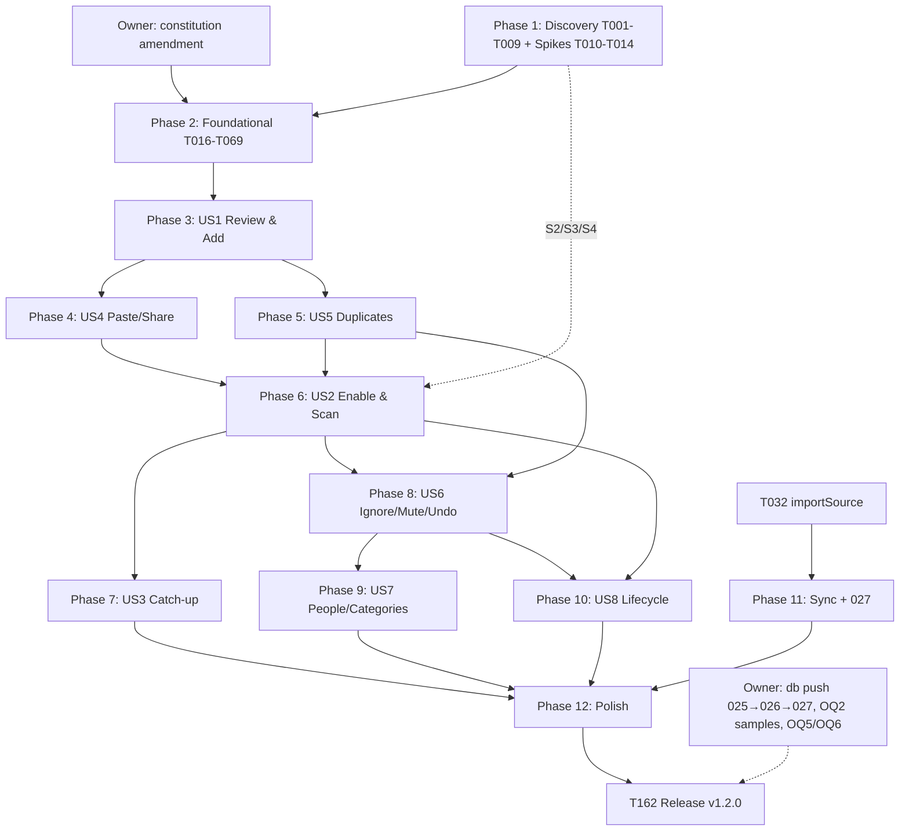

# Tasks: Bank SMS Transaction Import

**Input**: Design documents from `/specs/023-bank-sms-import/` — spec.md (US1-US8), plan.md (steps 0-20), research.md (Decisions 1-15), data-model.md, contracts/ (`sms-platform-channel.md`, `parser-contract.md`, `domain-interfaces.md`, `sync-wire-027.md`, `ui-contract.md`), quickstart.md, checklists/.

**Tests**: REQUESTED (spec Testing Strategy, plan Testing plan, and the user request). For the parser, crypto, confirm and duplicate code, write the tests first and confirm they fail before implementing.

**Pre-approval gate**: done. The constitution was amended to v1.1.0 on 2026-10-07, and Principle X now names SMS.

**Analysis remediation (2026-10-07)**: the `/speckit-analyze` findings are applied. Existing tasks were amended in place, and new tasks T163-T170 were added in their execution position. IDs were not renumbered, so every existing reference stays valid. Those new IDs are therefore not in numeric order within their phases.

## Format

```
- [ ] T### [P?] [US#?] Title: description with exact file path(s)
  - Type · Layer · Group (A-J from the request) · Depends
  - Accept: acceptance criteria
  - Tests: test requirements
  - Risk: only when material (L/M/H)
```

- **[P]**: can run in parallel with the other [P] tasks in the same phase whose dependencies are met. Two [P] tasks never touch the same file.
- **Groups**: A Discovery · B Domain · C Data · D Android · E iOS · F Application · G Presentation · H Privacy/Security · I Localization · J Testing.
- Paths are relative to the repo root. Feature root: `lib/features/sms_import/` (abbreviated `sms/` below). Test root: `test/features/sms_import/` (abbreviated `t/sms/`).
- Every use case and Cubit is annotated for `injectable`. Each phase checkpoint runs `dart run build_runner build --delete-conflicting-outputs` **once**. Individual tasks never run it, because the regenerated `injection.config.dart` and `app_database.g.dart` cause merge conflicts.

---

## Phase 1: Setup and Discovery (read-only plus spikes)

**Purpose**: Confirm the architecture assumptions the plan relies on and settle the device-only unknowns (S1-S4). This phase changes no production code.

Each discovery task writes its own notes file under `specs/023-bank-sms-import/discovery/`, so all nine can run in parallel. Each notes file lists `file:line` anchors and flags any place where the plan's assumption is wrong.

- [X] T001 [P] Inspect the transaction model and creation path: `lib/features/transactions/domain/entities/money_transaction.dart`, `domain/repositories/transactions_repository.dart`, `data/repositories/transactions_repository_impl.dart` (`addOcrSourcedTransaction`, idempotency-key handling, `created` audit row, `_validateAmountAndPerson`, `TransactionSource`). Write the notes to `specs/023-bank-sms-import/discovery/transactions.md`
  - Type: discovery · Layer: domain+data · Group: A · Depends: —
  - Accept: the notes name the exact write path that `addSmsSourcedTransaction` will copy, how it joins the caller's `db.transaction`, where the audit row is written, and the props/copyWith pattern of the entity.
  - Tests: none (read-only).
- [X] T002 [P] Inspect finance entry creation: `lib/features/finance/domain/entities/finance_entry.dart`, `finance_repository.dart`, `finance_repository_impl.dart` (`addEntry`, `_validateCategoryMatches`, the audit insert from v12). Write the notes to `discovery/finance.md`
  - Type: discovery · Layer: domain+data · Group: A · Depends: —
  - Accept: the notes name the validation and audit calls that `addSmsSourcedEntry` must reuse unchanged.
- [X] T003 [P] Inspect the BLoC/Cubit conventions: OCR review/confirm Cubits (`lib/features/ocr/presentation/cubit/`), the `_ConfirmAborted` rollback idiom in the OCR confirm path, `NotificationRecomputeTrigger` single-flight (`notification_recompute_trigger.dart:69`), state `copyWith`/Equatable style. Write the notes to `discovery/state-management.md`
  - Type: discovery · Layer: presentation · Group: A · Depends: —
  - Accept: the notes give a state-class template and the single-flight idiom to copy.
- [X] T004 [P] Inspect persistence: `lib/core/database/app_database.dart` (schemaVersion 12, `onUpgrade`), `migrations/migration_guards.dart`, `migrations/v12_finance_entry_audits.dart`, `data_wipe.dart`, `lib/core/sync/sync_entity_type.dart` (`localOnlyTables` ~line 55), the `NotificationPreferences` singleton pattern, the committed migration fixtures under `test/core/database/`. Write the notes to `discovery/persistence.md`
  - Type: discovery · Layer: data · Group: A · Depends: —
  - Accept: the notes confirm a v11 fixture exists (or flag that one must be committed) and list the existing tests that assert `schemaVersion`.
- [X] T005 [P] Inspect DI: `lib/core/di/injection.dart`, `injection.config.dart`, how `PlatformScreenshotProtectionService` and the AI credential services are registered, and whether a platform-conditional registration (`@Environment`, factory with `Platform.isAndroid`) already exists. Write the notes to `discovery/di.md`
  - Type: discovery · Layer: core · Group: A · Depends: —
  - Accept: the notes choose one mechanism for "Platform* on Android, Unavailable* on iOS/macOS" that matches existing code.
- [X] T006 [P] Inspect permissions and lifecycle: `request_notification_permission.dart` (`refresh()`), `app_settings` usage, `lib/core/security/app_lifecycle_observer.dart` (`runExternalActivity`, `isLocked` ValueListenable, async lock at `:143-147`, cold-launch lock `:68-70`), `NotificationTapRouter`, the `startup.whenReady` block in `lib/main.dart`, the screen-capture protection mechanism. Write the notes to `discovery/permissions-lifecycle.md`
  - Type: discovery · Layer: core+presentation · Group: A · Depends: —
  - Accept: the notes document how a route or page opts into secure-flag protection, and the exact post-frame point at which `isLocked` becomes reliable.
- [X] T007 [P] Inspect localization: `lib/core/l10n/app_en.arb`/`app_ar.arb`, `l10n.yaml`, the AI ARB parity test, the hardcoded-string guard, the full Arabic plural precedent (`app_ar.arb:284`), `CurrencyFormatter`, `AppDateFormatter`/`numeralLocaleFor`, the existing bidi isolation helper, `lib/core/l10n/failure_message.dart`. Write the notes to `discovery/localization.md`
  - Type: discovery · Layer: core · Group: A · Depends: —
  - Accept: the notes give the paths of the parity and guard tests to clone.
- [X] T008 [P] Inspect sync: `lib/features/transactions/data/sync/money_transaction_sync_mapper.dart`, `lib/features/finance/data/sync/finance_entry_sync_mapper.dart`, `ConflictResolver.keepTheirs`, `SyncWire` helpers, `SyncHarness`, the v1.0.1 mapper bodies at commit `c86e2df` (`git show c86e2df:<path>`), the 026 `sync_push` body in `supabase/migrations/20261005100000_026_finance_entry_audits.sql`. Write the notes to `discovery/sync.md`
  - Type: discovery · Layer: data+server · Group: A · Depends: —
  - Accept: the notes list the v1.0.1 `fromWire` bodies and the `SyncWire` helpers they call (`parseInstant` and others) that T149 must freeze verbatim.
- [X] T009 [P] Inventory the importers: every lib and test importer of `field_confidence.dart` and `confidence_indicator.dart` (plan: 8 lib + 10 test) and all 23 `NumeralParser` importers, split by role (input parsing vs post-processing of `intl` output). Write the notes to `discovery/importers.md`
  - Type: discovery · Layer: core · Group: A · Depends: —
  - Accept: the exact file list that T016 will edit; confirmation that no source or test contains U+06F0-U+06F9.

### Spikes (device; throwaway branch; plan step 0)

Each spike writes its own file in `specs/023-bank-sms-import/spikes/`, so they can run in parallel. No production code from a spike is kept.

- [ ] T010 [P] Spike S1: from Google Messages, share text while Daftary is backgrounded, through a throwaway `ShareTargetActivity`. Verify with `dumpsys activity activities` that exactly one `MainActivity` instance exists. Record the result in `spikes/S1-share-instance.md`
  - Type: spike · Layer: Android · Group: D · Depends: —
  - Accept: a device/OS list and the observed instance count.
  - Risk: M. The OEM trampoline behavior is the residual risk named in plan Unresolved Risk 4.
- [ ] T011 [P] Spike S2: test the provider selection grammar on API 26-36 emulators and one real device, in order: `UPPER(address) IN (...)`, then `COLLATE NOCASE`, `LIKE`, then a two-phase read. Record the result in `spikes/S2-provider-selection.md`
  - Type: spike · Layer: Android · Group: D · Depends: —
  - Accept: the grammar chosen for T106, with the devices tested.
  - Risk: H. A two-phase-read fallback weakens FR-020.
- [ ] T012 [P] Spike S3: test whether AGP `androidComponents.onVariants { it.sources.manifests.addStaticManifestFile(...) }` adds READ_SMS to `processReleaseMainManifest`. Otherwise prototype the manifest-only `:sms_capability` module. Record the result in `spikes/S3-manifest-overlay.md`
  - Type: spike · Layer: Android build · Group: D · Depends: —
  - Accept: the mechanism is chosen, and the merged-manifest path used by T105 is written down.
- [ ] T013 [P] Spike S4 and OQ5: on Android 14/15 real devices (including an Egyptian-market OEM), check the "no dialog shown" inference for restricted settings and the App info → overflow → "Allow restricted settings" steps. Also check whether Play Protect enhanced fraud protection applies in Egypt. Record the result in `spikes/S4-restricted-settings.md`
  - Type: spike · Layer: Android · Group: D · Depends: —
  - Accept: the inference is confirmed or corrected, the exact step copy for T119 is recorded, and the OQ5 answer is recorded.
  - Risk: H. This is a release gate (OQ5/OQ6).
- [ ] T163 [P] Spike S5: capture what Google Messages, Samsung Messages and iOS Messages produce when the user copies or shares one message and several messages (multi-select): sender lines, date or time headers, bracketed prefixes, separators, line breaks. Record the exact formats, with no real message content, in `spikes/S5-copy-share-envelopes.md`
  - Type: spike · Layer: platform · Group: D/E · Depends: —
  - Accept: one documented envelope format per app and mode, plus whether a single-message copy is byte-identical to the inbox body.
  - Risk: H. Feeds FR-017a and SC-006 (analysis H5).
- [ ] T014 Consolidate the S1-S5 outcomes into a "Spike addendum" section of `specs/023-bank-sms-import/research.md`. Where Decision 1, 2 or 3 is overturned, update `contracts/sms-platform-channel.md` §2.4
  - Type: docs · Layer: — · Group: D · Depends: T010, T011, T012, T013, T163
  - Accept: the addendum states the selection grammar, the overlay mechanism, the restricted-settings inference, the OQ5 status and the envelope table for the splitter; it does not leave any of them open.
- [X] T015 [P] Add `pointycastle: ^4.0.0` to `pubspec.yaml` with the research Decision 15 annotation comment, and run `fvm dart pub deps`
  - Type: setup · Layer: build · Group: H · Depends: —
  - Accept: `pubspec.lock` changes only the direct-dependency marker, with zero new packages.
  - Tests: `flutter analyze` is clean.

**Checkpoint**: discovery notes exist, spikes are resolved, and the owner has applied the constitution amendment.

---

## Phase 2: Foundational (blocking prerequisites)

**Purpose**: Shared core promotion, the pure domain, the parser engine, the v13 schema, crypto, the staging repository, the ingestion pipeline and the platform abstractions. Every user story depends on this phase.

**No user story work starts until this phase is green on `flutter analyze` and `flutter test`.**

### Core promotion and fixes (plan step 1; two separate commits)

- [X] T016 Promote the shared confidence types: `git mv lib/features/ocr/domain/entities/field_confidence.dart lib/core/confidence/field_confidence.dart` and `git mv lib/features/ocr/presentation/widgets/confidence_indicator.dart lib/core/design_system/confidence_indicator.dart`. Update only the imports in the files listed by T009, and move their tests to `test/core/confidence/` and `test/core/design_system/`
  - Type: refactor (mandated by Principle II) · Layer: core · Group: B · Depends: T009
  - Accept: zero behavior change; the diff contains only import lines and the moves.
  - Tests: all OCR suites pass unchanged, including `ocr_rtl_theme_test`.
  - Risk: L. **Not parallel with any task that edits OCR files.**
- [X] T017 [P] Extend `toWesternDigits` in `lib/core/money/numeral_parser.dart` to U+06F0-U+06F9, keeping the existing separator mapping. Make this its own commit
  - Type: feature · Layer: core · Group: C · Depends: T009
  - Accept: `۱۲۳٫۴۵` parses; Western strings are unchanged.
  - Tests: new cases in `test/core/money/numeral_parser_test.dart` for Eastern Arabic-Indic digits, mixed scripts and an unchanged Western string; then a full-suite run (23 importers).
  - Risk: L. This is strictly more permissive.
- [X] T018 [P] Add `kBankMessageImportFeatureEnabled = true` to `lib/core/config/feature_flags.dart`, in the style of `kOcrScanFeatureEnabled`. Do not add a capability const
  - Type: config · Layer: core · Group: G · Depends: —
  - Tests: extend `feature_flags_test`.

### Domain (Group B; pure Dart, no Flutter, Drift or `dart:io`)

- [X] T019 [P] Create the enums in `sms/domain/entities/sms_import_enums.dart`: `SmsSource` (`scan|catchup|paste|share`), `SmsImportStatus` (`pending|added|ignored|duplicate|expired`, with `dbValue`), `SmsKind`, `SmsDirection` (`debit|credit|unknown`), `SuggestedRecordType` (with `unset`), `SavedRecordType` (`moneyTransaction|financeEntry`), `TombstoneOutcome` (`added|ignored|duplicate|expired`), `SmsKind` including `authorizationReversal` (FR-024b), `SmsWarning` (the values of data-model §3.1, including `feeFromMessage`, `reversalHint` and `possibleOwnTransfer`), `ScanWindow` (7/30/90, default 30)
  - Type: domain model · Layer: domain · Group: B · Depends: —
  - Accept: every `dbValue` round-trips, and an unknown db string maps to a safe default without throwing.
  - Tests: `t/sms/domain/entities/sms_import_enums_test.dart`.
- [X] T020 [P] Create `ImportProvenance { sms, unknown }` in `lib/core/provenance/import_provenance.dart`, with `fromWire(String?)`: `'sms'` → `sms`, any other non-null string → `unknown`, null → null
  - Type: domain model · Layer: core · Group: B · Depends: —
  - Tests: `test/core/provenance/import_provenance_test.dart`.
- [X] T021 Create the parse result and confidence types in `sms/domain/entities/parse_result.dart` (`ParsedTransaction`, and a sealed `ParseResult` = `Parsed | NotRecognized | NonTransactional(kind) | Unreadable`) and `sms/domain/entities/parse_confidence.dart` (`ParseConfidence` per field, built on core `FieldConfidence`; `OverallConfidence high|medium|low`), as in parser-contract §4 and §6
  - Type: domain model · Layer: domain · Group: B · Depends: T016, T019
  - Accept: `ParsedTransaction` has no balance, OTP or full account-number field (FR-031).
  - Tests: equality tests.
- [X] T022 Create the `PendingSmsImport` entity in `sms/domain/entities/pending_sms_import.dart` with exactly the fields of data-model §3.1. Enforce these constraints verbatim: "`amountMinorUnits` > 0 and <= 12 whole digits when set"; "`merchant` <= 120 chars"; "`counterparty` <= 120 chars"; "`cardLast4` Exactly 4 digits"; "`expiresAt` = `createdAt + 30 days`"; "`suggestedCategoryId`/`suggestedPersonId` plain text, no FK"; "The entity never carries the sealed bytes or the plaintext" (only `hasRawText`); "`parentImportId` set only on a fee item split from its parent message (FR-030a), no FK"
  - Type: domain model · Layer: domain · Group: B · Depends: T019, T021
  - Tests: `t/sms/domain/entities/pending_sms_import_test.dart` (equality, invariants).
- [X] T023 [P] Create the entities `SmsImportTombstone` (constraint: "`purge_after >= created_at + 97 days`"; constraint: "No raw text, amount, merchant, name or digits"), `SmsSenderMute` (canonical upper-case `senderId`), `MerchantCategoryMapping` (PK `merchantKey`+`entryType`, `categoryId` with no FK) and `SmsImportSettings` (data-model §3.5 defaults: `isEnabled=false`, `scanWindow=30`, `countCashWithdrawals=false`, `rulesSeen={}`) in `sms/domain/entities/`, one file each
  - Type: domain model · Layer: domain · Group: B · Depends: T019
  - Tests: equality and default-value tests.
- [X] T024 [P] Create `SmsCapability {readSmsDeclared, isAndroid, available}` and `SmsPermissionStatus {granted, denied, permanentlyDenied, restrictedBlocked, revoked}` in `sms/domain/entities/sms_capability.dart` and `sms_permission_status.dart`
  - Type: domain model · Layer: domain · Group: B · Depends: —
  - Tests: `available == readSmsDeclared && isAndroid`.
- [X] T025 [P] Create the `SmsImportFailure extends Failure` set in `sms/domain/entities/sms_import_failures.dart` (domain-interfaces §1): `SmsCapabilityUnavailableFailure`, `SmsPermissionFailure(status)`, `SmsInboxQueryFailure`, `InputTooLargeFailure`, `NotRecognizedFailure`, `ImportAlreadyDecidedFailure`, `ImportIncompleteFailure(missing)`, `ProbableDuplicateFailure`, `OriginalUnavailableFailure`, `ScanNotAllowedFailure`
  - Type: domain model · Layer: domain · Group: B · Depends: —
  - Accept: no failure carries message text, amount, merchant or name (invariant 5).
  - Tests: a `message`/`toString` contains no injected sentinel digits.
- [X] T026 Create `ReviewDraft {type, amount, currency, date, categoryId?, personId?, note?}` in `sms/domain/entities/review_draft.dart`, with a pure `validate() → Set<ReviewField>` that mirrors the manual limits: "amount > 0 and <= 12 whole digits, catalog currency (EGP, USD, EUR, SAR, AED, GBP), note <= 500, category (expense/income) or person (given/received) required, valid date" (FR-043a, FR-044)
  - Type: domain rule · Layer: domain · Group: B · Depends: T019
  - Tests: `t/sms/domain/entities/review_draft_test.dart` as a table test covering each missing field and each limit edge.
- [X] T027 Create the shared value types in `sms/domain/entities/sms_value_types.dart` (domain-interfaces §6): `RawIncoming`, `NewPendingImport`, `ReparsedFields`, `ReparseCandidate`, `SavedRecordRef`, `KnownKeys`, `PurgeResult`, `ScanProgress`, `ScanCancellationToken`, `ScanSummary` (data-model §2: scanned, recognized, createdPending, **ready**, **needsReview**, alreadyKnown, nonTransactional, unreadable, mutedSkipped, cancelled, processedBeforeInterruption, plus an in-memory `skipped: List<SkippedEntry{bankId?, receivedAt?, reason}>`; content-free; FR-024, FR-097), `PasteImportResult`, `SmsImportCounts`, `CatchUpOutcome`/`ScanBlockReason`, `EnableResult`, `UndoResult`, `OriginalMessage`, `DuplicateFinding`, `SmsPreferenceChange` (sealed)
  - Type: domain model · Layer: domain · Group: B · Depends: T022, T024
  - Tests: equality; `ScanCancellationToken` cancel semantics.
- [X] T028 [P] Implement the pure rule `overallConfidence(fields, {capMedium})` in `sms/domain/rules/overall_confidence.dart`. Overall is the lowest read level among the required read fields; an inferred required field caps at Medium; generic, paste and share cap at Medium; any absent required field gives Low (FR-039 to FR-042)
  - Type: domain rule · Layer: domain · Group: B · Depends: T021
  - Tests: **write first** in `t/sms/domain/rules/overall_confidence_test.dart`, as a calibration table that includes "paste without date or currency is always Low".
- [X] T029 [P] Implement the pure rule `classifySmsPermission(result, previouslyRequested)` in `sms/domain/rules/classify_sms_permission.dart`
  - Type: domain rule · Layer: domain · Group: B · Depends: T024
  - Tests: **write first** in `t/sms/domain/rules/classify_sms_permission_test.dart`, with a table over every `{granted, dialogShown, shouldShowRationale, previouslyRequested}` combination.
- [X] T030 Create the ports in `sms/domain/services/`, one file each, with the signatures from domain-interfaces §2 and sms-platform-channel §6: `SmsInboxGateway`, `SmsPermissionService`, `SharedTextSource`, `SmsMessageParser`, `SmsTextNormalizer`, `SmsMasker`, `SmsMessageSplitter`, `RawTextVault`, `FingerprintHasher`, `SmsKeyStore`, `ClipboardReader`, `ReviewLeaseRegistry`, `LockStatus`, `ExternalActivityRunner`, `AppLifecycleStateSource` (resumed check for FR-008a), `ScanCoordinator` (one scan at a time, FR-013) and `FingerprintNormalizer` (frozen v1, FR-023)
  - Type: domain contract · Layer: domain · Group: B · Depends: T021, T022, T024, T025, T027
  - Accept: abstract classes only; no `dart:io`, Flutter or Drift import.
- [X] T031 Create the repository contracts `sms/domain/repositories/sms_import_repository.dart`, `sms_import_settings_repository.dart` and `sms_duplicate_lookup.dart`, with the method sets of domain-interfaces §3.1-§3.3
  - Type: domain contract · Layer: domain · Group: B · Depends: T022, T023, T027
- [X] T032 Add `final ImportProvenance? importSource` (default null, in `props` and `copyWith`) to `lib/features/transactions/domain/entities/money_transaction.dart` and `lib/features/finance/domain/entities/finance_entry.dart`. Leave `TransactionSource` unchanged. Add the derived getter `MoneyTransaction.provenance` (`ocr` when `source == ocr`, `sms` when `importSource == sms`, else `manual`) with a doc comment saying code must not test `source == manual` alone (data-model §3.6, analysis M8)
  - Type: domain model · Layer: domain · Group: B · Depends: T020, T001, T002
  - Accept: all existing constructors compile without changes.
  - Tests: existing entity tests pass, plus one equality case each.
  - Risk: L. **Same files as T146; run sequentially.**
- [X] T033 Add a domain purity guard in `t/sms/domain/domain_purity_guard_test.dart`: it greps `sms/domain/**` for `package:flutter`, `package:drift`, `dart:io` and `services.dart`, and asserts that `sms_import` and `ai_assistant` do not import each other in either direction
  - Type: test · Layer: domain · Group: J · Depends: T030, T031
- [X] T034 Create test fakes in `t/sms/helpers/fakes.dart`, one fake per port in T030 and T031: `FakeSmsInboxGateway` (paged canned rows that record calls), `FakeSmsPermissionService`, `FakeSharedTextSource`, `FakeLifecycle` (can flip to `paused`), `FakeLockStatus`, `InMemorySecureStorage` (with a throw switch), `FixedClock`, `FakeClipboardReader` (counts reads)
  - Type: test infra · Layer: test · Group: J · Depends: T030, T031

### Persistence (Group C; plan step 5). `app_database.dart` is a hotspot: one task at a time.

- [X] T035 Add `ensureColumn(table, column, ddl)` to `lib/core/database/migrations/migration_guards.dart`, guarded by `PRAGMA table_info`
  - Type: data infra · Layer: data · Group: C · Depends: T004
  - Tests: `test/core/database/migration_guards_test.dart` (idempotent on re-run).
- [X] T036 Add the five tables and two columns to Drift schema v13 in `lib/core/database/app_database.dart`: `PendingSmsImports`, `SmsImportTombstones`, `SmsSenderMutes`, `SmsMerchantCategoryMappings`, `SmsImportSettings` with every column, default and index of data-model §4.1-4.5 (including `parent_import_id` on `pending_sms_imports`) (`UNIQUE(fingerprint)`, `idx_sms_pending_status_expiry`, `idx_sms_pending_ref_hash`, `idx_sms_pending_amount_pair`, the four `idx_sms_tomb_*`), and nullable `import_source` text on `MoneyTransactions` and `FinanceEntries` ("no default, no backfill, no index"). Set `schemaVersion = 13`. Add the new `lib/core/database/migrations/v13_sms_import.dart` (one transaction, `ensureTable`/`ensureIndex`/`ensureColumn`, no existing row read or written), called under `if (from < 13)`. **In the same commit**, add the five tables to `localOnlyTables` in `lib/core/sync/sync_entity_type.dart` and delete them in `lib/core/database/data_wipe.dart`. Regenerate `app_database.g.dart`
  - Type: migration · Layer: data · Group: C · Depends: T035, T032, T019
  - Accept: do not touch `v12_finance_entry_audits.dart`; existing rows read `import_source = NULL`; `AppDatabase` is not opened with `logStatements`.
  - Tests: T037, T038.
  - Risk: M. This changes the schema of a live user database. After release, never edit v13; fix forward in v14.
- [X] T037 [P] Add migration tests in `test/core/database/v13_migration_test.dart`: the committed v11 fixture upgrades to 13 in one open; 12 → 13; re-open is idempotent; no existing row changes; the new columns are NULL. Update the `schemaVersion` assertions in `v12_migration_test.dart` and its siblings
  - Type: test · Layer: data · Group: J · Depends: T036
- [X] T038 [P] Update `test/core/sync/table_classification_guard_test.dart`, `test/core/database/data_wipe_test.dart` and `watch_tables_test.dart` for the five new tables
  - Type: test · Layer: data · Group: J · Depends: T036

### Crypto and secure storage (Group H; plan step 6). The three files are disjoint, so the tasks run in parallel.

- [X] T039 [P] Implement `SecureStorageSmsKeyStore` in `sms/data/crypto/secure_storage_sms_key_store.dart`. It manages keys `sms_import.enc_key.v1` and `sms_import.mac_key.v1` (32 random bytes each), generated lazily with single-flight and write-then-read-back, cached per process, and exposes `purge()`. It uses a **dedicated** `FlutterSecureStorage` instance with the same platform options as `register_module.dart:96-100` but `resetOnError: false`, registered under its own DI name (analysis M7). Any storage error maps to "key unavailable"
  - Type: security · Layer: data · Group: H · Depends: T015, T030
  - Tests: `t/sms/data/crypto/secure_storage_sms_key_store_test.dart` (concurrent first use yields one key; a throw maps to unavailable; purge deletes both keys; a read error on an SMS key leaves the other secure-storage entries intact).
  - Risk: M. The dedicated instance keeps an SMS key error from wiping the PIN hash, cloud session or AI key.
- [X] T040 [P] Implement `AesGcmRawTextVault` in `sms/data/crypto/aes_gcm_raw_text_vault.dart` with blob format "`0x01 | nonce(12) | ciphertext | tag(16)`", "AAD = pending id", a random nonce, and fixed-key/nonce test hooks. A tag failure or missing key returns "unreadable", which triggers a purge
  - Type: security · Layer: data · Group: H · Depends: T015, T030
  - Tests: **write first** in `t/sms/data/crypto/aes_gcm_raw_text_vault_test.dart`: round trip, tamper, AAD mismatch, wrong version byte, key loss, fixed vectors.
  - Risk: M (crypto misuse).
- [X] T041 [P] Implement `HmacFingerprintHasher` in `sms/data/crypto/hmac_fingerprint_hasher.dart` (HMAC-SHA256 with `crypto`): `fingerprint(fingerprintInput)` = `HMAC(mac, "fp1|" + input)`, where the input is the output of the frozen `FingerprintNormalizer` (T164), never `SmsTextNormalizer`; `feeFingerprint(input)` = `HMAC(mac, "fp1|fee|" + input)`; `refHash = HMAC(mac,"ref|"+bank+"|"+ref)`, `refAmountHash = HMAC(mac,"ra|"+bank+"|"+ref+"|"+currency+"|"+amountMinor+"|"+direction)`
  - Type: security · Layer: data · Group: H · Depends: T030
  - Tests: `t/sms/data/crypto/hmac_fingerprint_hasher_test.dart` (known vectors, determinism, independence from sender and time).

### Parser engine (Group C; plan step 3; test-first)

- [X] T042 [P] Write the normalizer tests first in `t/sms/data/parsing/sms_text_normalizer_test.dart`: bidi and zero-width stripping, whitespace, digits (ASCII, U+0660, U+06F0), separators, tatweel/alef/ya/ta marbuta folding for matching, lowercasing; the display text keeps the original letters
  - Type: test · Layer: data · Group: J · Depends: T030
- [X] T043 Implement `SmsTextNormalizer` in `sms/data/parsing/sms_text_normalizer.dart` following parser-contract §3
  - Type: parser · Layer: data · Group: C · Depends: T017, T030, T042
- [X] T164 Implement the frozen `FingerprintNormalizer` v1 in `sms/data/parsing/fingerprint_normalizer.dart`: a fixed copy of pipeline steps 1-3 (bidi and zero-width removal, whitespace collapse, digit normalization), with no letter folding, no lower-casing, and no import from `SmsTextNormalizer` or any parser file. Add the golden test `t/sms/data/parsing/fingerprint_golden_test.dart`: it computes every fixture's fingerprint with a fixed test key and compares it with `test/fixtures/sms/_fingerprints.json`; a separate case bumps a profile version and asserts the fingerprints are unchanged
  - Type: parser/integrity · Layer: data · Group: C+H · Depends: T017, T030, T041
  - Accept: an import guard shows the file depends only on `NumeralParser`; any edit to it fails the golden test (FR-023, analysis H1).
  - Risk: H. Without it, a rules update resurfaces decided messages (SC-006, SC-014).
- [X] T044 [P] Write the masker tests first in `t/sms/data/parsing/sms_masker_impl_test.dart`: digit runs of 12 or more in ASCII, Arabic-Indic and Eastern Arabic-Indic digits joined by a single space or hyphen keep only the last 4; Egyptian mobiles including `010 1234 5678` and Arabic-Indic forms; grouped amounts are untouched; an amount-adjacent run `EGP 1500 01012345678` masks only the mobile
  - Type: test · Layer: data · Group: J · Depends: T030
- [X] T045 Implement `SmsMaskerImpl` in `sms/data/parsing/sms_masker_impl.dart`, applying the mobile regex to a digit-normalized shadow copy with an index map
  - Type: privacy/parser · Layer: data · Group: H · Depends: T043, T044
  - Risk: M (an under-masking leak).
- [X] T046 [P] Write the splitter tests first in `t/sms/data/parsing/sms_message_splitter_test.dart`. Bounds: "<= 10,000 characters and <= 50 messages" (FR-017); exceeding them gives `InputTooLargeFailure`. Envelope stripping (FR-017a): every format recorded by S5 in `_paste/envelopes/` yields bodies byte-identical to the inbox copy after `FingerprintNormalizer`
  - Type: test · Layer: data · Group: J · Depends: T030
- [X] T047 Implement `SmsMessageSplitter` in `sms/data/parsing/sms_message_splitter.dart`, with step (0) envelope stripping driven by the app-level table `sms/data/parsing/sms_envelope_rules.dart` (parser-contract §3)
  - Type: parser · Layer: data · Group: C · Depends: T030, T046, T014 (S5 formats)
- [X] T048 Create the profile structures `sms/data/parsing/bank_profile.dart` and `sms_template.dart` following parser-contract §2: sender IDs, signatures, templates, kind rules, merchant keyword rules, `maskThreshold`, `defaultCurrency`, `dateOrder`, `version`, `refIsUnique` (FR-059b; generic is false)
  - Type: parser · Layer: data · Group: C · Depends: T021
- [X] T049 Write the engine tests first in `t/sms/data/parsing/rule_based_sms_parser_test.dart`. Cover: amounts (exact minor units via `CurrencyFormatter.parse`; more than 2 decimals or more than 12 whole digits is Unreadable and never clamped; the `FormatException` message is never copied); currencies (the word/symbol map; an unknown ISO code gives a null amount and the `unsupportedCurrency` warning); dates (Arabic Egyptian and Levantine month names, 2-digit years, year inference at the year edge through `AppClock`, 12/24-hour time, manual construction with a round-trip check); classification (non-transactional kinds: OTP, promo, decline, balance inquiry, pending authorization); precedence (sender+signature, then signature only, then generic, with no field merging); hostile input (huge, truncated, catastrophic-backtracking strings never throw and finish under a worst-case time budget); authorization reversal → `ParsedTransaction(kind: authorizationReversal, suggestedType: ignore, reversalHint)` and per-bank "purchase at authorization" wording → `cardPurchase` (FR-024b); an in-message fee is parsed into `fee` and never added to `amount` (FR-030a); `foreignAmount` populated for catalog currencies (FR-059); a year-less paste on Jan 2 for "30 Dec" → the previous year (FR-036); the received-timestamp day around Egypt's DST transitions and after a time-zone change stays on the stated or received local day (FR-038, analysis M16)
  - Type: test · Layer: data · Group: J · Depends: T048
- [X] T050 Implement `RuleBasedSmsParser` (`rule_based_sms_parser.dart`), `select_parse.dart`, `generic_profile.dart` (capped at Medium, `genericParser` warning) and `sms_parser_registry.dart` (`allowedSenders`, `currentVersions`; generic only for now) in `sms/data/parsing/`
  - Type: parser · Layer: data · Group: C · Depends: T043, T048, T049
  - Accept: anchored, non-nested quantifiers; per-message exceptions are contained.
  - Risk: M (regex backtracking).
- [X] T051 Implement the pure `suggestFor` in `sms/data/parsing/suggest_for.dart` (parser-contract §8): kind → suggested action; category by learned mapping, then keyword rules, then "other"; a person suggestion only on an existing-name match; cash-withdrawal preference from settings; an own-account or savings movement (explicit keywords only, FR-051c) → Ignore suggested; a refund credit → Ignore with the `refundHint` warning; an authorization reversal → Ignore with the `reversalHint` warning (FR-024b)
  - Type: domain mapping · Layer: data · Group: F · Depends: T050, T023
  - Tests: `t/sms/data/parsing/suggest_for_test.dart` (the spec mapping table, row by row; an archived category mapping is skipped).
- [X] T052 Build the corpus harness: the loader `t/sms/helpers/sms_fixture_loader.dart` and `t/sms/data/parsing/corpus_test.dart`, iterating `test/fixtures/sms/**`. It asserts `synthetic: true` on every file, no 16-digit run, no real-looking mobile number, the cross-bank non-match invariant and pinned `rule_version`; it applies the per-bank gate (≥ 95% on amount, currency, direction and date) and requires 100% noise rejection
  - Type: test infra · Layer: test · Group: J · Depends: T050
  - Accept: SC-001 runs as a `flutter test`.
- [X] T053 [P] Add the noise fixtures in `test/fixtures/sms/_noise/`: OTP, promo, decline, balance inquiry, pending authorization; Arabic, English and mixed; synthetic only
  - Type: test data · Layer: test · Group: J · Depends: T048
- [X] T054 [P] Add the paste, cross-bank and hostile fixtures in `test/fixtures/sms/_paste/` (multi-message, no date, no currency), `_cross/` and `_hostile/`: empty, truncated, mixed language, huge, missing amount, missing date, ambiguous direction, multiple amounts, unknown currency, spoofed sender, unsupported bank. Add `_paste/envelopes/` with re-authored synthetic versions of every S5 envelope format (single and multi-message), plus authorization-reversal and in-message-fee cases per kind
  - Type: test data · Layer: test · Group: J · Depends: T048

### Staging data layer (Group C; plan step 7)

- [X] T055 Implement `SmsImportDao` in `sms/data/datasources/sms_import_dao.dart` for pending rows and tombstones: insert-or-ignore on fingerprint, keyset-paged reads, `findKnown` (fingerprint and `ref_amount_hash` sets per page), and status updates
  - Type: data source · Layer: data · Group: C · Depends: T036
- [X] T056 [P] Implement `SmsImportSettingsDao` in `sms/data/datasources/sms_import_settings_dao.dart`: the lazily created settings singleton (`insertOnConflictUpdate`, as `NotificationPreferences` does), mutes, mappings, counters
  - Type: data source · Layer: data · Group: C · Depends: T036
- [X] T057 [P] Implement the mappers in `sms/data/models/pending_import_mapper.dart`, `tombstone_mapper.dart` and `settings_mapper.dart`. `hasRawText` is derived from `raw_blob IS NOT NULL`; the blob never enters the entity
  - Type: data mapping · Layer: data · Group: C · Depends: T036, T022, T023
  - Tests: round-trip mapper tests.
- [X] T058 Implement `SmsImportRepositoryImpl` (core part) in `sms/data/repositories/sms_import_repository_impl.dart`: `insertPending` (mask, then seal, then insert; a unique conflict is a no-op), `findKnown`, `watch`/`get`, `openOriginal` (decrypts; on failure nulls the blob and returns `OriginalUnavailableFailure`; parsed fields are kept), `deleteAllPending`, and a transition guard that rejects illegal transitions (data-model §6). Methods added later by stories: `confirm` (T074), `closeAsDuplicate` (T100), `ignore`/`undo`/`mute` (T131), `replaceParsedFields` (T127), `expireDue`/`purgeDecided` (T077)
  - Type: repository · Layer: data · Group: C · Depends: T055, T057, T039, T040
  - Tests: `t/sms/data/repositories/sms_import_repository_impl_test.dart` (idempotent staging across origins, illegal transitions rejected, key-loss purge, `raw_blob` not plaintext while pending).
  - Risk: M. **This file is edited by T074, T077, T100, T127 and T131, which must run sequentially.**
- [X] T059 [P] Implement `SmsImportSettingsRepositoryImpl` in `sms/data/repositories/sms_import_settings_repository_impl.dart`. `ScanWindow` is checked in code, not SQL; the cursor advances only after a page commits; counters are monotonic
  - Type: repository · Layer: data · Group: C · Depends: T056, T057
  - Tests: `t/sms/data/repositories/sms_import_settings_repository_impl_test.dart`.
- [X] T060 [P] Implement `SmsDuplicateDao` (implements `SmsDuplicateLookup`) in `sms/data/datasources/sms_duplicate_dao.dart`: one batched load of saved `money_transactions` and `finance_entries` (any source) over `[minDate-1d, maxDate+1d]` through the existing `(date, deleted_at)` indexes, plus tombstone and pending lookups. Add no new index
  - Type: data source · Layer: data · Group: C · Depends: T036, T031
- [X] T061 Implement the `CheckDuplicates` use case in `sms/domain/usecases/check_duplicates.dart`, applying the FR-059b order on the **draft's current values**: (1) exact fingerprint; (2) exact `refAmountHash`; (3) both `refHash` present and different → `legitimatelySimilar`, stop; (4) probable: same currency, same minor-unit amount, direction group (expense = given, income = received), date within one calendar day (calendar arithmetic), skipped when the existing record is SMS-sourced and both reference hashes differ; plus the 10-minute pending-pair rule. Tier 2 applies only when the profile's `refIsUnique` is true, else it also needs a date within one day (FR-059b). The probable tier also compares a stated `foreignAmount` against saved records in that currency (FR-059), and ranks candidates by merchant/note similarity then closest date, returning the best one (analysis M4). Add `possibleOwnTransfer` for an opposite-direction pair of equal amount and currency within one day from a different bank or channel, among pending items and SMS-sourced saved records (FR-051d). For an `authorizationReversal` item, return the matching saved expense or Given record (same `refHash`, or same amount and currency within one day) (FR-024b). It never blocks (FR-063). The person-scoped `FindPossibleDuplicate` is untouched
  - Type: use case · Layer: domain · Group: F · Depends: T060, T026, T058
  - Tests: **write first** in `t/sms/domain/usecases/check_duplicates_test.dart` (each tier, both edges of the one-day window, the tier-3 stop rule, a fee SMS sharing a reference but with a different amount, `refIsUnique` false needing the date, a foreign-amount match, ranking, an own-transfer pair across banks and none within the same bank, the reversal match).
  - Risk: M (subtle semantics).
- [X] T062 Implement `SmsIngestionService` (`sms/domain/services/sms_ingestion_service.dart`) and the `ParseMessages` use case following domain-interfaces §5.2. Steps: normalize → parse → fingerprint from the frozen `FingerprintNormalizer` (T164, never `SmsTextNormalizer`) and hashes from the **unmasked** body (computed once); an in-message `fee` stages a second pending fee item with `parentImportId` and fingerprint `fp1|fee|...` (FR-030a) → `findKnown` → mask → seal → `insertPending` → content-free counts. Each page is committed together with its cursor advance. Cancellation between messages keeps the items already created. One hostile message never stops the batch (FR-098); raw bodies are dropped after the page
  - Type: use case/service · Layer: domain+data · Group: F · Depends: T045, T047, T050, T051, T040, T041, T058, T059
  - Tests: `t/sms/domain/services/sms_ingestion_service_test.dart` (a strict mock asserts zero calls to `TransactionsRepository`/`FinanceRepository` (SC-002, invariant 1); malformed-message isolation; idempotent re-ingest; cancel keeps created items; non-transactional and unreadable store nothing).
  - Risk: M.

### Platform abstraction, l10n base, privacy guards, DI

- [X] T063 [P] Add `UnavailableSmsInboxGateway`, `UnavailableSmsPermissionService`, `UnavailableSharedTextSource` (registered on iOS and macOS only, never on Android) and `SystemClipboardReader` (`Clipboard.getData(Clipboard.kTextPlain)`, called only on request) in `sms/data/platform/`
  - Type: platform · Layer: data · Group: E · Depends: T030
  - Tests: `t/sms/data/platform/unavailable_ports_test.dart`.
- [X] T064 [P] Implement `SmsChannelClient` in `sms/data/platform/sms_channel_client.dart`: an injectable `MethodChannel('com.daftary.daftary/sms')` and `EventChannel('.../sms/shared_text')`; error codes map to typed failures per sms-platform-channel §3; no message content in exceptions
  - Type: platform · Layer: data · Group: D · Depends: T030
  - Tests: `t/sms/data/platform/sms_channel_client_test.dart` with canned replies through `TestDefaultBinaryMessengerBinding`.
- [X] T065 [P] Add the app adapters in `sms/data/platform/`: `InMemoryReviewLeaseRegistry`, `AppLockStatus` (wraps the `AppLifecycleObserver.isLocked` ValueListenable), `AppExternalActivityRunner` (wraps `runExternalActivity`), and the lifecycle-state source
  - Type: platform · Layer: data · Group: F · Depends: T030, T006
  - Tests: `t/sms/data/platform/app_adapters_test.dart`.
- [X] T165 [P] Implement `InMemoryScanCoordinator` (`ScanCoordinator` port) in `sms/data/platform/in_memory_scan_coordinator.dart`. It allows one scan at a time: an explicit scan cancels a running catch-up through its token and waits for it to finish; a catch-up requested while any scan runs returns `skipped(alreadyRunning)` (FR-013, analysis M11)
  - Type: application infra · Layer: data · Group: F · Depends: T030
  - Tests: `t/sms/data/platform/in_memory_scan_coordinator_test.dart` (exclusion, cancel-and-wait, skip).
- [X] T066 Map `SmsImportFailure` → `smsImportError*` in `lib/core/l10n/failure_message.dart`, and add the `smsImportError*` keys to `lib/core/l10n/app_en.arb` and `app_ar.arb`: `@key` descriptions; full Arabic `=0/=1/=2/few/many/other` for any plural; no technical text; no content. Clone the parity test as `t/sms/presentation/l10n_parity_test.dart` (comparing plural/select category sets for `smsImport*` only; `syncStatusPending` is left alone) and the hardcoded-string guard as `t/sms/presentation/hardcoded_string_guard_test.dart` (over `sms/presentation/`)
  - Type: l10n · Layer: core+presentation · Group: I · Depends: T025, T007
  - Accept: `flutter gen-l10n` is clean.
  - Tests: a failure-to-message mapping test.
  - **The ARB files are a hotspot: every later task that adds keys runs sequentially with the others.**
- [X] T067 [P] Add the static privacy guards in `t/sms/privacy/static_guards_test.dart`. They fail on `print(`, `debugPrint(`, `developer.log` or `Log.` under `lib/features/sms_import`, and on `println(`, `printStackTrace(`, `System.out` or `Log.` in `SmsPlugin.kt`/`ShareTargetActivity.kt` (skipping files that do not exist yet). They also fail on any import of analytics or crash-reporting packages in `sms_import`
  - Type: security test · Layer: test · Group: H · Depends: —
  - Accept: covers the analytics and crash-reporting restrictions (FR-100).
- [X] T068 [P] Create the `BankMessagesRoutes` constants (hub, enable, paste, ignored, senders, learned, `review(id)`, settings) in `sms/presentation/routes.dart`, following ui-contract §1
  - Type: presentation · Layer: presentation · Group: G · Depends: —
- [X] T069 Register every Phase 2 implementation in DI using the platform mechanism chosen in T005 (Platform* or Unavailable*), then run `build_runner` once to regenerate `lib/core/di/injection.config.dart` and `app_database.g.dart`
  - Type: DI · Layer: core · Group: F · Depends: T036, T039-T041, T043, T045, T047, T050, T058-T065, T164, T165
  - Accept: the app builds on Android, iOS and macOS.
  - Tests: full `flutter test` and `flutter analyze` are green.

**Checkpoint**: the foundation is ready. A synthetic message can be staged in a unit test, and no screen exists yet.

---

## Phase 3: User Story 1 - Review and add a bank message as a transaction (P1) 🎯 MVP core

**Goal**: A pending import is reviewed, edited and explicitly Added; nothing is saved otherwise.

**Independent Test**: Seed a pending import through `SmsIngestionService` with a synthetic SMS, open review, edit one field and tap Add. Then verify: exactly one record carries the edited value; `import_source = 'sms'`; a `created` audit row exists; `raw_blob` is NULL. Separately verify zero records for items that were never Added.

- [X] T070 [P] [US1] Write the confirm tests first in `t/sms/data/repositories/confirm_test.dart`: rollback on an inner `Left` (`_ConfirmAborted`); double confirm and two concurrent confirms yield exactly one record; retry after a type switch; kill before and after commit (simulated); tombstone `added`; `raw_blob = NULL`; identity-shell scrub including `sender_id`; learned-mapping upsert only when the category differs; `created` audit row present; `import_source = 'sms'`; people-ledger rows keep `source = manual` (FR-086)
  - Type: test · Layer: data · Group: J · Depends: T058, T034
- [X] T071 [P] [US1] Write the review Cubit tests first in `t/sms/presentation/cubit/import_review_cubit_test.dart`: load; edit; type switch moves the required field between category and person; Add disabled until `validate()` is empty; double-tap Add (single-flight); `ImportAlreadyDecidedFailure`; unsaved-edit prompt flag; advance to the next item; redacted `toString`
  - Type: test · Layer: presentation · Group: J · Depends: T034
- [X] T072 [US1] Add `addSmsSourcedTransaction` to `lib/features/transactions/domain/repositories/transactions_repository.dart` and `data/repositories/transactions_repository_impl.dart`, modeled on `addOcrSourcedTransaction`: it runs inside the caller's transaction, uses idempotency key `sms-import:<pendingId>`, validates through the same `_validateAmountAndPerson`, writes a `created` audit row identical to manual creation, sets `import_source='sms'`, keeps `source = manual`, and carries the doc comment "only the SMS repository calls this"
  - Type: repository extension · Layer: data · Group: C · Depends: T032, T036, T001
  - Tests: covered by T070; existing transaction suites pass unchanged.
  - Risk: **H**. This is one of the core money write paths. The change is additive only, and no existing signature changes.
- [X] T073 [P] [US1] Add `addSmsSourcedEntry` to `lib/features/finance/domain/repositories/finance_repository.dart` and `finance_repository_impl.dart` with the same contract, reusing `_validateCategoryMatches` (category type equals entry type; category active) and the v12 audit insert
  - Type: repository extension · Layer: data · Group: C · Depends: T032, T036, T002
  - Risk: **H**. Its files are disjoint from T072, so the two can run in parallel.
- [X] T074 [US1] Implement `SmsImportRepositoryImpl.confirm` in `sms_import_repository_impl.dart` as one `db.transaction`: re-read the row and require `pending`; call `addSmsSourcedTransaction` or `addSmsSourcedEntry`; insert the tombstone; set `added`, `decided_at`, `saved_record_*`; null `raw_blob`; scrub the content columns; upsert the learned mapping when needed; increment `addedCount`. Any `Left` throws a private `_ConfirmAborted` to roll back
  - Type: repository · Layer: data · Group: C · Depends: T058, T072, T073, T070
  - Accept: T070 is green.
  - Risk: H (FR-075a atomicity).
- [X] T075 [US1] Add a single-review-gate guard in `t/sms/privacy/single_review_gate_guard_test.dart`: `addSmsSourcedTransaction`/`addSmsSourcedEntry` have exactly one non-test caller, `SmsImportRepositoryImpl.confirm` (invariant 2)
  - Type: test · Layer: test · Group: J · Depends: T074
- [X] T076 [US1] Add the read and review use cases in `sms/domain/usecases/`: `GetPendingImports` (low confidence first, then oldest), `WatchPendingImports`, `WatchPendingImportCount`, `GetPendingImport` (`NotFoundFailure`), `ShowOriginalMessage` (direction from `Bidi.detectRtlDirectionality`; `OriginalUnavailableFailure`), and `AddImportedTransaction` (load → `draft.validate()` → `CheckDuplicates` unless `duplicateOverride` → `confirm`; no batch variant)
  - Type: use case · Layer: domain · Group: F · Depends: T061, T074
  - Tests: one test file per use case under `t/sms/domain/usecases/`.
- [X] T077 [US1] Add `ExpirePendingImports`, `GetExpiredNotice` and `AcknowledgeExpiredNotice`, plus the repository methods `expireDue` (tombstone `expired`, null blob, keep only the six Undo fields) and `purgeDecided` (decided rows after 30 days; tombstones after `purge_after`)
  - Type: use case · Layer: domain+data · Group: F · Depends: T058, T059
  - Tests: `t/sms/domain/usecases/expire_pending_imports_test.dart` (idempotent; scrub; notice count uses `expired_notice_seen_at`).
- [X] T078 [US1] Implement `ImportReviewCubit` and its state in `sms/presentation/cubit/import_review_cubit.dart`/`_state.dart`: the draft is a value object, Add is single-flight, the review lease is acquired and released, the duplicate-sheet request is a state flag consumed through `BlocListener`, `toString` is redacted
  - Type: cubit · Layer: presentation · Group: G · Depends: T076, T065, T071
  - Accept: T071 is green.
- [X] T079 [US1] Implement `BankMessagesCubit` (list part) in `sms/presentation/cubit/bank_messages_cubit.dart`: pending list, ordering, expired notice, `ExpirePendingImports` run on open
  - Type: cubit · Layer: presentation · Group: G · Depends: T076, T077
  - Tests: `t/sms/presentation/cubit/bank_messages_cubit_test.dart`.
  - **US2, US6 and US8 extend this Cubit; those tasks run sequentially.**
- [X] T080 [P] [US1] Add the widgets `sms/presentation/widgets/bidi_text.dart` (first-strong direction, isolation), `pending_import_card.dart` (confidence semantics, stable key by id, no color-only meaning) and `import_type_selector.dart` (expense/income/given/received only; Repayment and occasion contribution are not offered), reusing `AppCard` and `ConfidenceIndicator`
  - Type: widget · Layer: presentation · Group: G · Depends: T016, T068
  - Tests: `t/sms/presentation/widgets/*_test.dart` (semantics, 48dp, RTL).
- [X] T081 [US1] Build `BankMessagesPage` (list, skeleton loading, empty state explaining scan/paste/share, typed error with retry, expired notice) in `sms/presentation/pages/bank_messages_page.dart`. Add the `smsImportPending*` keys (en + ar, full Arabic plurals) and the `/bank-messages` route in `lib/core/routing/app_router.dart` (People-branch `ShellRoute`; static paths before the parameterized one)
  - Type: page · Layer: presentation · Group: G+I · Depends: T079, T080, T066
  - Risk: L. **This task touches the ARB files and the router (hotspots).**
- [X] T082 [US1] Build `ImportReviewPage` in `sms/presentation/pages/import_review_page.dart` from `AppTextField` (amount via `CurrencyFormatter.parse`), `AppDateField`, `CurrencyPicker`, `CategoryPickerField`, `PersonPickerField`: per-field confidence and inferred markers; read-only SMS time with "only the day is saved"; read-only original-currency context; note never prefilled (optional "use merchant" action); show-original as a private widget in its own direction; Add disabled with the missing field named in text; unsaved-edit prompt; header with bank name, masked account and source label (FR-043); one-tap chips for two amount candidates (FR-030); the FR-024b reversal hint with a read-only card of the matched record and "Open it"; for a split fee, the line linking to its parent (FR-030a); the `possibleOwnTransfer` line (FR-051d), all per ui-contract §3.4. Add the `smsImportReview*`/`smsImportKind*`/`smsImportSuggest*`/`smsImportWarning*`/`smsImportSemantics*` keys and the `/bank-messages/review/:importId` route (declared last)
  - Type: page · Layer: presentation · Group: G+I · Depends: T078, T080, T081
  - Accept: the manual form pages and their Cubits are not imported (FR-044, SC-012).
  - Risk: M (largest UI surface). **Hotspot files: run sequentially after T081.**
- [X] T083 [US1] Add the `ImportedFromSmsLabel` widget in `lib/core/design_system/imported_from_sms_label.dart` ("Imported from a bank message" / "مستورد من رسالة بنكية", screen-reader label) with the `smsImportProvenance*` keys
  - Type: widget · Layer: core · Group: G+I · Depends: T020, T082 (ARB serialization)
- [X] T084 [US1] Show `ImportedFromSmsLabel` when `importSource == sms` in the transaction list tile and history widgets under `lib/features/transactions/presentation/widgets/` and in `lib/features/finance/presentation/widgets/finance_entry_list_tile.dart`
  - Type: widget integration · Layer: presentation · Group: G · Depends: T083, T032
  - Tests: widget tests for label present and absent; existing tile tests unchanged.
- [X] T085 [US1] Verify FR-079 coverage. Screenshot protection is already enabled app-wide at startup (`lib/main.dart:34-38`), so no per-route work is needed. Add a regression test asserting that nothing in `sms_import` calls `ScreenshotProtectionService.disable()`, and that the list, review and paste routes sit behind the existing App Lock gate
  - Type: security verification · Layer: presentation · Group: H · Depends: T081, T082
  - Tests: `t/sms/privacy/screen_protection_guard_test.dart`.
- [X] T086 [P] [US1] Write the widget tests `t/sms/presentation/pages/bank_messages_page_test.dart` and `import_review_page_test.dart`: loading, empty, error and success states; Add disabled with the missing field announced; show-original unavailable after a decision; semantics; 48dp; large text; RTL × LTR × light × dark
  - Type: test · Layer: presentation · Group: J · Depends: T081, T082

**Checkpoint**: run build_runner. US1 is independently testable with seeded items.

---

## Phase 4: User Story 4 - Paste (iOS and Android) or share (Android) (P1) 🎯 MVP entry

**Goal**: Get pending items in on every platform without any SMS permission.

**Independent Test**: Paste synthetic text, and (on Android) share the same text. Verify identical pending items. Verify zero clipboard reads before the Paste tap.

- [X] T087 [P] [US4] Write the paste Cubit tests first in `t/sms/presentation/cubit/paste_cubit_test.dart`: paste-tap read, empty clipboard, bounds exceeded, not recognized (nothing stored), multi-message summary, consume from `SharedTextInbox` once, redacted `toString`
  - Type: test · Layer: presentation · Group: J · Depends: T034
- [X] T088 [US4] Add the `ImportPastedText` use case (splitter bounds → ingest with `sender = null`, `receivedAt = null`, capped at Medium; `NotRecognizedFailure` when nothing is recognized, with nothing stored) and `ReadClipboardText` (calls `ClipboardReader` only)
  - Type: use case · Layer: domain · Group: F · Depends: T062, T063
  - Tests: `t/sms/domain/usecases/import_pasted_text_test.dart`.
- [X] T089 [US4] Add the in-memory `SharedTextInbox` (`sms/presentation/shared_text_inbox.dart`; cleared on consume) and the `ImportSharedText` use case (takes the initial share and the stream, waits for `isLocked == false`)
  - Type: use case · Layer: domain+presentation · Group: F · Depends: T088, T065
- [X] T090 [US4] Implement `PasteCubit` and its state in `sms/presentation/cubit/paste_cubit.dart`
  - Type: cubit · Layer: presentation · Group: G · Depends: T088, T089, T087
- [X] T091 [US4] Build `PasteBankMessagePage` in `sms/presentation/pages/paste_bank_message_page.dart`: a multi-line field with `enableIMEPersonalizedLearning: false`, `autocorrect: false` and `enableSuggestions: false`; a Paste button that reads the clipboard only inside `onPressed`; the bounds message; the recognized/skipped summary; a not-recognized state with a manual-entry link; a "nothing to paste" state. Add the `smsImportPaste*`/`smsImportShare*` keys and the `/bank-messages/paste` route (no text in the URL). Apply secure-flag protection
  - Type: page · Layer: presentation · Group: G+I+E · Depends: T090, T082 (hotspot serialization)
- [X] T092 [P] [US4] Write `t/sms/presentation/pages/paste_bank_message_page_test.dart`: a mocked `flutter/platform` channel records **zero** `Clipboard.getData` calls before the tap (open, resume, focus, route push); the privacy flags are set; bounds; RTL/theme; large text
  - Type: test · Layer: presentation · Group: J · Depends: T091
- [X] T093 [US4] Add `android/app/src/main/kotlin/com/daftary/daftary/ShareTargetActivity.kt` (translucent, `noHistory`, `excludeFromRecents`; puts `EXTRA_TEXT` into an in-process holder; starts `MainActivity` with `NEW_TASK|CLEAR_TOP|SINGLE_TOP`; calls `finish()`). Declare it in `android/app/src/main/AndroidManifest.xml` with an `ACTION_SEND text/plain` filter, and add `tools:node="remove"` for RECEIVE_SMS, SEND_SMS, RECEIVE_MMS, RECEIVE_WAP_PUSH, WRITE_SMS and READ_PHONE_STATE
  - Type: platform · Layer: Android · Group: D · Depends: T014
  - Accept: `MainActivity`'s launch mode is untouched; no logging.
  - Risk: M. **`AndroidManifest.xml` is a hotspot.**
- [X] T094 [US4] Create `SmsPlugin.kt` (share part): `getCapabilities` (`readSmsDeclared` from the package manager), `getInitialSharedText` (once, then cleared), the shared-text `EventChannel`, the 10,001-character truncation flag, typed error codes, no logging. Register it next to `SecurityPlugin` in `MainActivity.configureFlutterEngine`, in every Android build
  - Type: platform · Layer: Android · Group: D · Depends: T093, T064
  - Risk: M. **US2 (T106) extends `SmsPlugin.kt`, so it runs after this task.**
- [X] T095 [US4] Implement `PlatformSharedTextSource` in `sms/data/platform/platform_shared_text_source.dart`, registered whenever `Platform.isAndroid` is true (including the capability-off build)
  - Type: platform · Layer: data · Group: D · Depends: T094, T064
  - Tests: `t/sms/data/platform/platform_shared_text_source_test.dart` (once-only; works with `readSmsDeclared = false` without making any inbox or permission call).
- [X] T096 [US4] Implement `SharedTextRouter` in `sms/presentation/shared_text_router.dart` (waits for unlock, then `go(BankMessagesRoutes.paste)`; the text lives only in `SharedTextInbox`; precedent `NotificationTapRouter`) and start it in the `startup.whenReady` block of `lib/main.dart`
  - Type: app wiring · Layer: presentation · Group: F · Depends: T089, T091, T095
  - Risk: M. **`main.dart` is a hotspot (T128 also edits it).**
- [X] T097 [P] [US4] Write `t/sms/presentation/shared_text_router_test.dart`: waits for unlock, consumes once, cold and warm share, no text in the route or `extra`
  - Type: test · Layer: presentation · Group: J · Depends: T096
- [X] T098 [US4] Add the Home quick action "Bank message" to `lib/features/dashboard/presentation/widgets/quick_action_row.dart` (`showBankMessage = kBankMessageImportFeatureEnabled`, `bankMessageLocation`; Android with capability → hub, otherwise → paste; `onReturn` refresh) and wire it in `home_page.dart`
  - Type: entry point · Layer: presentation · Group: G · Depends: T091, T018
  - Tests: quick-action routing per platform/capability; the existing dashboard tests pass.
  - **`home_page.dart` is a hotspot (T122 and T129 also edit it).**

**Checkpoint**: run build_runner. **MVP = US1 + US4**: paste → review → Add works on iOS and Android with no SMS permission.

---

## Phase 5: User Story 5 - Duplicate protection (P1)

**Goal**: Exact duplicates collapse silently; probable duplicates warn side by side; similar items do not warn.

**Independent Test**: Import the same SMS twice (it collapses); import a message that matches a manual entry (warning); import two same-merchant purchases with different references (no warning).

- [X] T099 [P] [US5] Write the duplicate scenario suite in `t/sms/domain/duplicate_scenarios_test.dart` against a real in-memory DB: re-scan, re-paste and re-share of the same message; byte-identical bodies; a fee SMS that shares a reference but has a different amount gives two items; probable matches against manual, OCR and SMS records; both references different gives no warning; one-day window edges; the re-check on Add uses edited values; an authorization reversal after an added purchase shows the matched record (FR-024b); an in-message fee yields exactly two pending items, and re-ingesting yields none (FR-030a); a cross-bank own-transfer pair is flagged on both items (FR-051d); a purchase typed in USD matches an EGP-billed SMS that states USD (FR-059); a short reused reference on a `refIsUnique: false` bank does not collapse messages days apart (FR-059b)
  - Type: test · Layer: domain+data · Group: J · Depends: T061, T062, T074
- [X] T170 [P] [US5] Add a cross-path fingerprint test in `t/sms/domain/cross_path_fingerprint_test.dart`: the same synthetic message through scan (fake gateway), catch-up, paste and share, including every `_paste/envelopes/` format, yields one pending item and one fingerprint (FR-017a, FR-023, SC-006). Also check that a parser version bump followed by a re-scan resurfaces nothing
  - Type: test · Layer: domain+data · Group: J · Depends: T062, T088, T164, T047
- [X] T100 [US5] Add the `CloseAsDuplicate` use case and `SmsImportRepositoryImpl.closeAsDuplicate` (tombstone `duplicate`, blob nulled, identity-shell scrub, no record touched)
  - Type: use case · Layer: domain+data · Group: F · Depends: T074
  - Tests: a repository test.
- [X] T101 [US5] Add the widgets `sms/presentation/widgets/duplicate_comparison_card.dart` and `probable_duplicate_sheet.dart` (`ProbableDuplicateSheet` via `AppModalSheet`; existing vs pending, with type, amount, date and source label; actions "It's different, add anyway", "It's the same, don't add", Cancel) and the `smsImportDuplicate*` keys
  - Type: widget · Layer: presentation · Group: G+I · Depends: T082 (ARB serialization), T083
  - Accept: the transactions `DuplicateWarningSheet` is not touched.
- [X] T102 [US5] Wire duplicates into `ImportReviewCubit`/`ImportReviewPage`: check when the review opens; raise the sheet late on `ProbableDuplicateFailure` at Add; "add anyway" → `duplicateOverride: true`; "same" → `CloseAsDuplicate` and advance
  - Type: integration · Layer: presentation · Group: F+G · Depends: T100, T101, T078
- [X] T103 [P] [US5] Write the sheet and Cubit tests (`t/sms/presentation/widgets/probable_duplicate_sheet_test.dart`, with additions to the review Cubit test), with semantics. Then re-run the existing `FindPossibleDuplicate` and `DuplicateWarningSheet` suites unchanged
  - Type: test · Layer: presentation · Group: J · Depends: T102

**Checkpoint**: P1 trust gate met across every entry path.

---

## Phase 6: User Story 2 - Android: enable and scan recent bank messages (P1)

**Goal**: Opt-in, READ_SMS after an explanation, a window scan over recognized senders only.

**Independent Test**: In a capability build on a device with synthetic bank and non-bank SMS, enable and scan. Only the bank message becomes pending, the non-bank body is never read, and a re-scan adds nothing.

**Parallel lanes**: Lane A (T104 → T105, T106 → T107) is Android/Gradle. Lane B (T108 → T109) is Dart use cases against fakes. Lane C (T110-T116) is bank profiles. The three lanes share no files.

- [X] T104 [US2] Add the capability gate: `android/app/build.gradle.kts` reads the `DAFTARY_SMS_IMPORT` provider (with a `-Pdaftary.smsImport=true` fallback) and adds the READ_SMS-only overlay chosen by S3 (`android/app/sms_capability/AndroidManifest.xml` via `androidComponents.onVariants`, or the fallback module `android/sms_capability/*` plus an `android/settings.gradle.kts` include). No `--dart-define` and no Dart const
  - Type: build · Layer: Android · Group: D · Depends: T014
  - Accept: with the env unset, the merged manifest has no SMS permission; with it set, the manifest has READ_SMS only.
  - Risk: M (AGP path drift).
- [X] T105 [US2] Add `tool/check_merged_manifest.sh` and an `android-manifest` job in `.github/workflows/ci.yml` that runs it with the env unset and set. It asserts: no RECEIVE_SMS, SEND_SMS or READ_PHONE_STATE; no `SMS_RECEIVED`, `SMS_DELIVER` or `WAP_PUSH_DELIVER` intent filter anywhere; no receiver or service declared by the SMS code (the existing `flutter_local_notifications` receivers are allowed); the SEND filter on `ShareTargetActivity` is present
  - Type: CI · Layer: build · Group: D+H · Depends: T104, T093
  - **`ci.yml` is a hotspot (T151 also edits it).**
- [X] T106 [US2] Extend `SmsPlugin.kt` with `getPermissionState`, `requestPermission` (request code `0x5A11`, `dialogShown` from the activity pause, `shouldShowRationale`) and `queryInbox` (the selection grammar from S2, `date ASC, _id ASC`, at most 200 rows per page, sender filter inside the selection so non-bank bodies are never read). Also add the install-source helper. Codes only, no logging
  - Type: platform · Layer: Android · Group: D · Depends: T094, T104, T014
  - Risk: **H** (device-only, OEM-variable).
- [X] T107 [US2] Implement `PlatformSmsInboxGateway` and `PlatformSmsPermissionService` in `sms/data/platform/`. Import `app_settings` with the prefix `app_settings`; `openAppInfo` uses the default details settings. Both short-circuit when `readSmsDeclared` is false
  - Type: platform · Layer: data · Group: D · Depends: T106, T064
  - Tests: `t/sms/data/platform/platform_sms_inbox_gateway_test.dart` and `platform_sms_permission_service_test.dart` (argument shaping, page boundaries, `permission_denied`, empty page, capability-off short-circuit).
- [X] T108 [P] [US2] Write the use-case tests first in `t/sms/domain/usecases/`: `run_inbox_scan_test.dart` (the allow-list is profile senders minus mutes; cursor reset; short page ends the scan; defensive sender re-check; a fake lifecycle flipping to `paused` mid-scan → no further `queryInbox`, `cancelled=true`, cursor kept; `lastScanAt` set) and `enable_sms_import_test.dart`/`request_sms_permission_test.dart` (`permissionRequested` persisted; refused when the capability is unavailable; explanation precondition)
  - Type: test · Layer: domain · Group: J · Depends: T034
- [X] T109 [US2] Add the use cases `GetSmsCapability`, `GetSmsPermissionStatus`, `RequestSmsPermission` (the only caller of `request()`, wrapped in `ExternalActivityRunner`), `OpenSmsAppInfo`, `EnableSmsImport`, `UpdateSmsImportPreferences`, `GetScanCounts` and `RunInboxScan` (inside `ScanCoordinator.runExclusive`, cancelling a running catch-up) in `sms/domain/usecases/`
  - Type: use case · Layer: domain · Group: F · Depends: T062, T065, T165, T029, T108
  - Accept: T108 is green with fakes. No dependency on T104-T107.
- [X] T110 [P] [US2] Add the NBE profile `sms/data/parsing/profiles/nbe_profile.dart` and synthetic fixtures `test/fixtures/sms/nbe/` (Arabic, English and mixed, for each kind: card purchase, ATM, transfer in and out, InstaPay, salary, bill, refund, fee) with the gate test `t/sms/data/parsing/profiles/nbe_profile_test.dart`
  - Type: parser · Layer: data · Group: C · Depends: T052; owner samples (OQ2/OQ3)
  - Accept: ≥ 95% on the four fields, 100% noise rejection, cross-bank non-match. **If the bank misses the gate, it is not registered.**
  - Risk: **H** (sample quality, template drift).
- [X] T111 [P] [US2] Add the Banque Misr profile `banque_misr_profile.dart` with fixtures `test/fixtures/sms/banque_misr/` and a gate test, as in T110 · Group C · Depends: T052, OQ2 · Risk: H
- [X] T112 [P] [US2] Add the CIB profile `cib_profile.dart` with fixtures `test/fixtures/sms/cib/` and a gate test · Group C · Depends: T052, OQ2 · Risk: H
- [X] T113 [P] [US2] Add the QNB Alahli profile `qnb_alahli_profile.dart` with fixtures `test/fixtures/sms/qnb/` and a gate test · Group C · Depends: T052, OQ2 · Risk: H
- [X] T114 [P] [US2] Add the Banque du Caire profile `banque_du_caire_profile.dart` with fixtures `test/fixtures/sms/banque_du_caire/` and a gate test · Group C · Depends: T052, OQ2 · Risk: H
- [X] T115 [P] [US2] Add the AAIB profile `aaib_profile.dart` with fixtures `test/fixtures/sms/aaib/` and a gate test · Group C · Depends: T052, OQ2 · Risk: H
- [X] T116 [P] [US2] Add the InstaPay profile `instapay_profile.dart` with fixtures `test/fixtures/sms/instapay/` and a gate test · Group C · Depends: T052, OQ2 · Risk: H
- [X] T117 [US2] Register every profile that passed its gate in `sms/data/parsing/sms_parser_registry.dart`, in one commit, with versions pinned
  - Type: parser · Layer: data · Group: C · Depends: T110-T116 (whichever passed)
  - Tests: `corpus_test.dart` is green over all registered banks.
  - **This is the only task that edits the registry, which keeps the parallel profile tasks conflict-free.**
- [X] T118 [US2] Implement `EnableFlowCubit` (explanation → request → classified state → window → scan; the explanation must be acknowledged before the request) and `BankMessagesSettingsCubit` in `sms/presentation/cubit/`
  - Type: cubit · Layer: presentation · Group: G · Depends: T109
  - Tests: `t/sms/presentation/cubit/enable_flow_cubit_test.dart` and `bank_messages_settings_cubit_test.dart`.
- [X] T119 [US2] Build `SmsPermissionBanner` (`sms/presentation/widgets/sms_permission_banner.dart`: denied, permanently denied, restricted with numbered Android 15 steps from T013 plus "Open App info", revoked; the paste/share fallback is always offered) and `EnableBankMessagesPage` (explanation of what is read, what is never done and how to turn it off; window 7/30/90). On return from App info or system settings, the flow re-checks the status and retries the grant once (FR-072). Add the `smsImportEnable*`/`smsImportPermission*`/`smsImportRestricted*` keys and the `/bank-messages/enable` route
  - Type: page · Layer: presentation · Group: G+I · Depends: T118, T101 (hotspot serialization)
  - Risk: M (device-dependent UX; SC-015).
- [X] T120 [US2] Extend `BankMessagesCubit`/`BankMessagesPage` with scan progress (count plus cancel), the content-free scan summary ("N found: R ready, V need review, S skipped", plural) with the in-memory Skipped list (bank, date, reason, never text; FR-024, FR-097) and the permission/state banner. Add the `smsImportScan*` keys
  - Type: cubit+page · Layer: presentation · Group: G+I · Depends: T109, T081, T119
- [X] T121 [US2] Build `BankMessagesSettingsPage` (window, cash-withdrawal toggle, counters; the SMS rows are hidden when capability is unavailable). Add the Settings tile (key `settings_bank_messages_entry`, after Notifications/Currency) in `lib/features/settings/presentation/pages/settings_page.dart`, the `smsImportSettings*` keys and the `/settings/bank-messages` route
  - Type: page · Layer: presentation · Group: G+I · Depends: T118, T120
- [X] T122 [US2] Add the onboarding variant of `lib/features/dashboard/presentation/widgets/bank_messages_home_card.dart` (Android, capability available, not enabled, not dismissed; "Set up" → enable; "Dismiss" is permanent), placed below the people summary in `home_page.dart`. Its Cubit is created only when the flag and capability allow it, and the dashboard Cubit is untouched. Add the `smsImportHome*` keys
  - Type: entry point · Layer: presentation · Group: G+I · Depends: T121, T098
- [X] T123 [P] [US2] Write the permission widget tests `t/sms/presentation/pages/enable_bank_messages_page_test.dart` and `sms_permission_banner_test.dart` (one per state, restricted guidance), a **startup test** asserting no `requestPermission` call during app start (FR-002), and tile visibility by capability
  - Type: test · Layer: presentation · Group: J · Depends: T119, T121, T122
- [X] T124 [US2] In `.github/workflows/release-android.yml`, set `DAFTARY_SMS_IMPORT=true` and add an `aapt dump permissions` step on the APK(s) asserting READ_SMS is present, RECEIVE_SMS/SEND_SMS/READ_PHONE_STATE are absent, and the share filter is present
  - Type: CI · Layer: build · Group: D+H · Depends: T104

**Checkpoint**: run build_runner. The Android scan path works end to end on a device with the capability build.

---

## Phase 7: User Story 3 - Android: automatic catch-up on open (P2)

**Goal**: New recognized messages appear on foreground; no background work.

**Independent Test**: With the feature on, deliver synthetic SMS while the app is closed (including after a force-stop), then open the app. Each message appears once as pending, and no record is created.

- [X] T125 [P] [US3] Write the tests first: `t/sms/domain/usecases/run_catch_up_scan_test.dart` (skipped when disabled, not granted, locked, in flight or within the debounce; 24-hour cursor overlap; 90-day cap; disable or revocation between pages stops it; `paused` between pages stops it; runs Expire and Reparse at the end; never throws) and `t/sms/presentation/sms_catch_up_trigger_test.dart` (checks `isLocked` only after a post-frame callback; single-flight; 60-second debounce)
  - Type: test · Layer: domain+presentation · Group: J · Depends: T034
- [X] T126 [US3] Add the `RunCatchUpScan` use case following domain-interfaces §5.2 (single-flight joining a `Future<bool>? _inFlight`, inside `ScanCoordinator.runExclusive`, skipped while an explicit scan runs)
  - Type: use case · Layer: domain · Group: F · Depends: T109, T077, T125, T165
  - Risk: M (lifecycle races).
- [X] T127 [US3] Add the `ReparsePending` use case and `SmsImportRepositoryImpl.replaceParsedFields`. It runs when `currentVersions` differs from `rulesSeen`, skips leased items, never touches hashes, treats a masked amount as unreadable, keeps the fields when the blob cannot be opened, and updates `rulesSeen`
  - Type: use case · Layer: domain+data · Group: F · Depends: T058, T065, T050, T100 (repository file serialization)
  - Tests: `t/sms/domain/usecases/reparse_pending_test.dart`.
- [X] T128 [US3] Add `SmsCatchUpTrigger` in `sms/presentation/sms_catch_up_trigger.dart` (a lifecycle observer that is a sibling of `NotificationRecomputeTrigger`) and start it in `lib/main.dart`. It also runs `ExpirePendingImports` after unlock at app start
  - Type: app wiring · Layer: presentation · Group: F+D · Depends: T126, T127, T096 (`main.dart` serialization)
  - Accept: no receiver, service or WorkManager (the T105 script still passes).
- [X] T129 [US3] Add the count variant of `BankMessagesHomeCard` (rendered only while the count is above 0; count only, plural, with no merchant, amount or text; tap → hub; no tab badge). Add a dashboard ordering test asserting all three new Home surfaces sit below the people summary
  - Type: entry point · Layer: presentation · Group: G+I · Depends: T122, T076
  - Tests: `test/features/dashboard/presentation/bank_messages_home_card_test.dart` and a dashboard ordering test.

---

## Phase 8: User Story 6 - Ignore, mute and undo (P2)

**Goal**: Keep the list clean; undo for 30 days.

**Independent Test**: Ignore one item, mute a sender and Undo one item. Ignored items never resurface, the muted sender yields nothing, and an undone item returns only after a re-scan or re-paste.

- [X] T130 [P] [US6] Write the repository tests first in `t/sms/data/repositories/ignore_undo_mute_test.dart`: ignore (tombstone, blob nulled, six Undo fields kept, the rest nulled); batch ignore; undo deletes the row and tombstone; `MuteSender` deletes that sender's pending rows in the same transaction with **no tombstones** (invariant 8); muted senders are excluded from the allow-list
  - Type: test · Layer: data · Group: J · Depends: T058
- [X] T131 [US6] Add the repository methods `ignore`, `undo` and `mute`/`unmute` (in `sms_import_repository_impl.dart` and the settings repository), and the use cases `IgnoreImport` (single or set), `UndoIgnore` (`needsRescan: true`), `WatchUndoList`, `MuteSender`, `UnmuteSender` and `WatchMutedSenders`
  - Type: use case · Layer: domain+data · Group: F · Depends: T130, T127 (repository file serialization)
- [X] T132 [US6] Add multi-select and batch Ignore with an `AppConfirmDialog` to `BankMessagesCubit`/`BankMessagesPage` (no "add all"), and the Ignore and "Stop suggesting from this sender" actions (only when `senderId` is set; the confirm says pending items from that sender are removed) to the review page
  - Type: cubit+page · Layer: presentation · Group: G · Depends: T131, T120, T102
- [X] T133 [US6] Build `IgnoredImportsCubit` and `IgnoredImportsPage` (30-day list of the six fields only; Undo copy per ui-contract §3.8: "It will come back when you tap Scan now, or paste or share this message again." Catch-up does not re-read older messages, so the copy names Scan). Add the `smsImportIgnored*` keys and the `/bank-messages/ignored` route
  - Type: page · Layer: presentation · Group: G+I · Depends: T131, T121 (hotspot serialization)
- [X] T134 [US6] Build `MutedSendersCubit` and `MutedSendersPage` with unmute. Add the `smsImportMute*` keys and the `/bank-messages/senders` route
  - Type: page · Layer: presentation · Group: G+I · Depends: T131, T133
- [X] T135 [P] [US6] Write the Cubit and widget tests for T132-T134 (state transitions, RTL/theme, semantics)
  - Type: test · Layer: presentation · Group: J · Depends: T132, T133, T134

---

## Phase 9: User Story 7 - Transfers, people and categories (P2)

**Goal**: Better suggestions, with no person auto-created; learned categories persist.

**Independent Test**: Import a transfer naming an existing person and a purchase. The person is suggested and not created. A corrected category is suggested for the same merchant next time.

- [X] T136 [P] [US7] Write the tests first: suggestion cases in `t/sms/data/parsing/suggest_for_test.dart` (incoming transfer with a name match → Income default plus a one-tap Received suggestion; no match → no person; own-account → Ignore), and `t/sms/domain/usecases/learned_mapping_test.dart` (the mapping wins over keywords; an archived category is skipped and left in place)
  - Type: test · Layer: domain · Group: J · Depends: T051
- [X] T137 [US7] Feed existing people names into ingestion (read-only, through the existing people repository) so `suggestFor` can set `suggestedPersonId` only on an existing-name match
  - Type: use case · Layer: domain+data · Group: F · Depends: T062, T136
  - Accept: no person is ever created by ingestion.
- [X] T138 [US7] Add the transfer and people UX to the review page: a one-tap "record as Received from <person>"; create a person through the existing `CreatePerson` only after an explicit tap; the own-account Ignore hint; the cash-withdrawal default from settings; the existing similar-name choice when more than one person matches (FR-054); the one-line ATM link to the cash-withdrawal preference (FR-051b). Add the related `smsImportSuggest*` keys
  - Type: page · Layer: presentation · Group: G+I · Depends: T137, T102, T134 (ARB serialization)
- [X] T139 [US7] Add `WatchLearnedMappings`, `RemoveLearnedMapping` and `ClearLearnedMappings`, plus `LearnedCategoriesCubit` and `LearnedCategoriesPage` (shows "category removed" for missing categories). Add the `smsImportMappings*` keys and the `/bank-messages/learned` route
  - Type: page · Layer: presentation · Group: F+G+I · Depends: T059, T138
- [X] T140 [P] [US7] Write the widget and Cubit tests for T138-T139
  - Type: test · Layer: presentation · Group: J · Depends: T138, T139

---

## Phase 10: User Story 8 - Permission and feature lifecycle (P2)

**Goal**: Predictable off, revoke, delete-all and restore behavior.

**Independent Test**: Revoke the permission while backgrounded and return. The "permission off" state shows, pending items stay reviewable, and paste/share still works.

- [X] T141 [P] [US8] Write the tests first: `t/sms/domain/usecases/disable_sms_import_test.dart` (disable first so a running scan stops between pages; delete-pending is optional; mutes, mappings and tombstones are kept), `t/sms/privacy/delete_all_test.dart` (the five tables and both keys are gone), a revocation-on-resume Cubit test, and a key-loss test (fields kept, show-original unavailable)
  - Type: test · Layer: domain+data+presentation · Group: J+H · Depends: T034
- [X] T142 [US8] Add the `DisableSmsImport` and `ClearSmsImportData` use cases, and the disable action with a "also delete pending imports?" dialog on `BankMessagesSettingsPage`
  - Type: use case+page · Layer: domain+presentation · Group: F+G+I · Depends: T121, T131, T139 (ARB serialization)
- [X] T143 [US8] Refresh `GetSmsPermissionStatus` on resume in `BankMessagesCubit`/`BankMessagesSettingsCubit`. A revoked permission shows the "off" banner, keeps pending items and never re-prompts (FR-012, FR-070)
  - Type: cubit · Layer: presentation · Group: G · Depends: T120, T107, T132 (Cubit file serialization)
- [X] T144 [US8] Add the `PurgeSmsImportKeys` use case and inject it into `lib/features/data_privacy/domain/usecases/delete_all_user_data.dart` beside `PurgeAIAssistantCredentials`
  - Type: privacy · Layer: domain · Group: H · Depends: T039
  - Tests: T141 `delete_all_test`; the existing delete-all suite passes.
- [X] T145 [US8] Verify and fix the restore behavior: after the key is lost, the review shows parsed fields, "Show original" is disabled with its localized reason, and old tombstones not matching is accepted (FR-062)
  - Type: behavior · Layer: presentation+data · Group: H · Depends: T082, T058, T141

---

## Phase 11: Sync provenance and server migration 027 (cross-cutting; release-blocking)

**Purpose**: `import_source` travels optionally without breaking v1.0.1. Phases 3-10 do not depend on this phase, so it can run any time after T032.

- [X] T146 Change both sync mappers (`money_transaction_sync_mapper.dart`, `finance_entry_sync_mapper.dart`) so `toWire` adds `import_source` only when it is non-null, and `fromWire` reads `importSource: Value((json['import_source'] as String?) ?? existingLocal?.importSource)`. A non-null local value is never downgraded
  - Type: sync · Layer: data · Group: C · Depends: T032, T008
  - Risk: M. **The entity files from T032 must already be merged.**
- [X] T147 [P] Add `supabase/migrations/20261006100000_027_import_source.sql`: a nullable `import_source text check (import_source in ('sms'))` on both tables, and `create or replace function public.sync_push` that is byte-identical to the 026 body except for `'import_source'` appended to the two `v_business` arrays, with a comment naming 027. The pull functions are untouched; 021-026 are never edited
  - Type: migration (server) · Layer: server · Group: C · Depends: T008
  - Accept: a `diff` against the 026 body shows only the two array additions.
  - Risk: **H**. A bad `sync_push` would affect every device. **The user runs `supabase db push`; the agent never does.**
- [X] T148 [P] Add pgTAP `supabase/tests/027_import_source.test.sql` covering: (a) an upsert persists; (b) a v1.0.1-shaped update leaves the value intact; (c) old rows are NULL; (d) the check rejects `'x'`; (e) the pull includes the key; (f) a create retry spanning the deploy returns `conflict` as documented (sync-wire-027 §6 case 7)
  - Type: test · Layer: server · Group: J · Depends: T147
- [X] T149 [P] Freeze the v1.0.1 `fromWire` bodies from `c86e2df` **together with the `SyncWire` helpers they call** into `test/core/sync/legacy/v101_mappers.dart`, and add `v101_pull_compat_test.dart` (post-027 rows plus an invented future key are accepted)
  - Type: test · Layer: data · Group: J · Depends: T008
- [X] T150 Add mapper tests in `test/features/transactions/data/sync/` and `test/features/finance/data/sync/`: the exact wire shape (key absent when null); a pull with the key absent keeps local `'sms'`; a pull with the key present and null keeps local `'sms'`; the same through `ConflictResolver.keepTheirs`; a legacy edit-push keeps the field. Add a two-device `SyncHarness` provenance test and an offline "Add, then sync later" case
  - Type: test · Layer: data · Group: J · Depends: T146, T149
- [X] T151 Add the legacy sync test directory to the UTC re-run list in `.github/workflows/ci.yml`
  - Type: CI · Layer: build · Group: J · Depends: T149, T105 (`ci.yml` serialization)

---

## Phase 12: Polish and cross-cutting gates

- [X] T152 [P] Add the privacy sentinel leak suite in `t/sms/privacy/leak_suite_test.dart`. Push a sentinel message through scan, paste, share, review, Add, Ignore, expiry and re-parse, and assert that no sentinel appears in: captured `debugPrint`, `Zone` print or `FlutterError.onError` output (crash-report sanitization); outbox rows; CSV export; `SELECT *` over every table (TEXT and BLOB). Also assert `raw_blob` is NULL after every decision and is not plaintext while pending, `AppDatabase` does not use `logStatements`, and `toString` is redacted
  - Type: security test · Layer: test · Group: H+J · Depends: T074, T091, T096, T127, T131
- [X] T153 [P] Add the offline suite `t/sms/offline_flows_test.dart`: every flow (scan with the fake gateway, paste, review, Add, Ignore, Undo, mute) with a no-connectivity fake succeeds, and no flow surfaces a network error
  - Type: test · Layer: test · Group: J · Depends: T131, T109
- [X] T154 [P] Add the benchmark `test/performance/sms_ingest_scale_test.dart` (a clone of `ocr_batch_scale_test.dart`): 500 messages, recognized and unrecognized, in ≤ 5 s; duplicate maps per batch. The result decides whether pages go to `compute` and whether partial indexes are needed (a v14 follow-up only if the budget is missed)
  - Type: perf test · Layer: test · Group: J · Depends: T062, T117
  - Risk: M (low-end devices).
- [X] T155 [P] Add an export regression test: `ExportUserData` has no dependency on any `sms_import` interface and no provenance header (invariant 7). `export_user_data.dart` stays untouched
  - Type: test · Layer: test · Group: H+J · Depends: T144
- [ ] T166 [P] Add the device benchmark for SC-005 in `integration_test/sms_ingest_device_benchmark_test.dart`: profile mode on the reference device (4 GB RAM or less, released 2022 or later), 500 messages through the fake gateway plus the real parser, DB and crypto, asserting ≤ 5 s. Record the device and the result in `quickstart.md`
  - Type: perf test · Layer: test · Group: J · Depends: T154
  - Risk: M. A miss moves pages to `compute` (T154 decision).
- [ ] T167 Owner gate, not code: run the Arabic-first usability sessions (≥ 8 participants) for SC-004 (median ≤ 10 s from review to saved), SC-010 (≥ 90% say nothing is saved until Add) and SC-015 (≥ 80% finish the Android 15 enable flow in ≤ 2 minutes). Record the results in `specs/023-bank-sms-import/usability.md`
  - Type: release gate · Layer: — · Group: J · Depends: T158
- [X] T168 [P] Add the SC-014 test `t/sms/domain/rescan_90_day_test.dart`: with a fixed clock, decide items (add, ignore, duplicate, expire), advance past `purgeDecided` (30 days) to day 90, re-scan the same messages, and assert zero new pending items while tombstones remain until `purge_after`
  - Type: test · Layer: domain+data · Group: J · Depends: T077, T100, T131
- [X] T169 [P] Add the financial totals test `test/features/dashboard/sms_import_totals_test.dart`: Add one item of each kind through `AddImportedTransaction` and assert the dashboard income, expense and people totals (022 rule: given and received never count as income or expense; a split fee counts as one expense; an Ignored reversal or own transfer changes nothing)
  - Type: test · Layer: domain+presentation · Group: J · Depends: T076, T102, T138
- [X] T156 Review localization, accessibility and RTL in `app_en.arb`/`app_ar.arb` (copy and plural corrections only; native Arabic review; full Arabic plural sets; error and permission copy). Check amounts and dates go through `CurrencyFormatter`/`AppDateFormatter` with no concatenation, progress and duplicate announcements, and contrast in both themes. Run `flutter gen-l10n`. Add `t/sms/presentation/rtl_theme_test.dart` covering every new screen in RTL × LTR × light × dark with large text
  - Type: l10n/a11y · Layer: presentation · Group: I+J · Depends: T081-T143 (all screens)
  - Risk: M (Arabic copy quality).
- [X] T157 Run the regression suites unchanged (SC-012): manual transaction and finance forms; OCR flow and the moved confidence tests; `FindPossibleDuplicate`; export; delete-all; notification-tap routing; App Lock gate; the whole `NumeralParser` suite; dashboard isolation
  - Type: test · Layer: all · Group: J · Depends: T156
- [X] T158 Add `integration_test/sms_import_flows_test.dart` (device only, not CI): paste → review → Add; Android scan with a fake gateway → Ignore; duplicate warning; permission-off state; share cold and warm with App Lock
  - Type: integration test · Layer: all · Group: J · Depends: T157
- [X] T159 [P] Check iOS and macOS: `ios/Runner/*`, `Info.plist`, entitlements and `SecurityPlugin.swift` show zero diff; the macOS runner builds; iOS paste works in the simulator
  - Type: verification · Layer: iOS/macOS · Group: E · Depends: T091
- [ ] T160 Walk through quickstart.md on Android 14/15 devices (including an Egyptian-market OEM) and iOS. Clear the release gates OQ5 (Play Protect, Egypt) and OQ6 (restricted settings). If OQ5 fails, switch `release-android.yml` to the two-APK matrix (same key, applicationId and versionCode; distinct artifact names)
  - Type: verification · Layer: all · Group: D · Depends: T158, T124
  - Risk: **H** (installs could be blocked for all users).
- [X] T161 Update the docs: `PRODUCT.md` (add 023: "on-device only, confirm per item") and `README.md` (feature note; sideload and Play Protect caveats); re-run `/speckit-analyze` (the spec wording was corrected on 2026-10-07)
  - Type: docs · Layer: — · Group: — · Depends: T160
- [ ] T162 Prepare the release: bump `pubspec.yaml` to `version: 1.2.0+4` and tag v1.2.0 **only after** v1.1.0 (022) has shipped and the user has pushed 025 → 026 → 027 and verified it with T148 against the target
  - Type: release · Layer: build · Group: — · Depends: T147, T148, T160, T161, T166, T167; owner db push
  - Risk: H.

---

## Group index (request groups A-J → tasks)

| Group | Tasks |
|---|---|
| A Discovery | T001-T009 |
| B Domain | T019-T032 (import models T022-T023, parser result T021, confidence T021/T028, source metadata T019/T020, duplicate status T019/T027 `DuplicateFinding`, import status T019, use-case contracts T030-T031) |
| C Data | T017, T035-T038, T043, T047, T048, T050, T164, T055-T060, T072-T074, T110-T117 (bank parsers), T146-T147 |
| D Android | T010-T014, T163, T064, T093-T095, T104-T107, T124, T128, T160 |
| E iOS | T063, T091 (paste is the iOS path), T159. No Share Extension: it is a non-goal per Clarifications |
| F Application | T051, T061, T062, T065, T069, T165, T076, T077, T088, T089, T096, T100, T102, T109, T126, T127, T131, T137, T142 (scan T109; parse T062; validate T026/T076; duplicate check T061; review/edit T078; save T074/T076; ignore T131; retry via the same idempotency key, T070/T074) |
| G Presentation | T018, T068, T078-T086, T090-T092, T098, T101-T103, T118-T123, T129, T132-T135, T138-T140, T143 |
| H Privacy/Security | T015, T039-T041, T045, T067, T075, T085, T105, T124, T144, T145, T152, T155 (secure storage T039; filtering T045 and the T106 selection; analytics and crash T067/T152; logging T067; deletion T142/T144) |
| I Localization | T066, T081-T083, T091, T101, T119-T122, T129, T133, T134, T138, T139, T142, T156 |
| J Testing | parser unit T042/T044/T046/T049; Arabic, English and bank fixtures T053/T054/T110-T116; malformed T054; duplicate T061/T099; mapping T051/T136; widget T086/T092/T103/T123/T135/T140; integration T158; permission T029/T123; offline T153/T150; sync T148-T150; security T033/T067/T075/T085/T152/T155; localization T066/T156; RTL T156 plus each page test; regression T157; fingerprint integrity T164/T170; SC-014 T168; financial totals T169; device performance T166; usability gate T167 |

---

## Dependencies and execution order

### Dependency graph (phase level)



The story-to-story edges come from **shared files** (the review page, `BankMessagesCubit`, the repository impl, the ARB files), not from domain coupling. Each story's logic stays independently testable with fakes.

### Task-level chains (must be sequential)

- **Domain spine**: T016 → T021 → T022 → T027 → T030 → T031 → T034
- **Schema**: T035 → T036 → {T037, T038} → T055 → T058
- **Parser**: T042 → T043 → T045; T041 → T164 → T062; T163 → T014 → T047; T048 → T049 → T050 → {T051, T052} → T110-T116 → T117
- **Pipeline**: T058 + T059 + T060 → T061 → T062 → T088 (paste) / T109 (scan) → T126 (catch-up)
- **Confirm**: T032 → {T072 ∥ T073} → T074 → T076 → T078 → T082
- **Android**: T014 → T093 → T094 → T104 → T106 → T107
- **Server**: T147 → T148 → owner `db push` → T162

### Critical path

The engineering critical path (longest chain to release):

T009 → T016 → T021 → T022 → T027 → T030 → T040 → T058 → T074 → T076 → T078 → T082 → T101 → T102 → T119 → T120 → T121 → T133 → T134 → T138 → T139 → T142 → T156 → T157 → T158 → T160 → T161 → T162

Three external items can stretch it, and they should be started on day one:
1. **OQ2/OQ3 real bank samples**: these gate T110-T116, then T117, then T154.
2. **Spikes S2/S3/S4/S5**: these gate T104, T106 and the splitter (T047).
3. **Owner deploys 025 → 026 → v1.1.0 → 027**: this gates T162.

### Parallelizable groups (safe; disjoint files)

| Window | Run together |
|---|---|
| Phase 1 | T001-T013, T015 and T163 (all [P]); T014 waits for T010-T013 and T163 |
| Phase 2 domain | {T019, T020, T024, T025} → {T023, T026, T028, T029} |
| Phase 2 mid | {T037, T038}, {T039, T040, T041}, {T042, T044, T046}, {T053, T054}, {T056, T057}, {T059, T060}, {T063, T064, T065, T067, T068, T165} |
| US1 | {T070, T071}, {T072, T073}, T080 alongside T076-T079 |
| US2 | Lane A (T104 → T105, T106 → T107) ∥ Lane B (T108 → T109) ∥ Lane C (T110-T116) |
| Cross-phase | Phase 11 (T146-T151) ∥ Phases 3-10, once T032 has merged; T147/T148/T149 are [P] with each other |
| Polish | {T152, T153, T154, T155, T159} |

### Do NOT run concurrently (same file or module)

| Hotspot | Tasks that must be serialized |
|---|---|
| `lib/core/l10n/app_en.arb`, `app_ar.arb` | T066, T081, T082, T083, T091, T101, T119, T120, T121, T122, T129, T133, T134, T138, T139, T142, T156 |
| `lib/core/routing/app_router.dart` | T081, T082, T091, T119, T121, T133, T134, T139 |
| `sms/data/repositories/sms_import_repository_impl.dart` | T058 → T074 → T077 → T100 → T127 → T131 |
| `sms/presentation/cubit/bank_messages_cubit.dart` and page | T079/T081 → T120 → T132 → T143 |
| `import_review_cubit.dart` / `import_review_page.dart` | T078/T082 → T102 → T132 → T138 |
| `lib/core/database/app_database.dart` and `.g.dart` | T036 only (any later schema change needs v14) |
| `lib/core/di/injection.config.dart` (generated) | only at phase checkpoints (T069 and each "Checkpoint") |
| `lib/main.dart` | T096 → T128 |
| `lib/features/dashboard/presentation/pages/home_page.dart` | T098 → T122 → T129 |
| `money_transaction.dart`, `finance_entry.dart` | T032 → T146 |
| `transactions_repository_impl.dart` / `finance_repository_impl.dart` | T072 / T073 only (disjoint from each other, so they can run in parallel) |
| `SmsPlugin.kt` | T094 → T106 |
| `AndroidManifest.xml`, `build.gradle.kts` | T093 → T104 |
| `.github/workflows/ci.yml` | T105 → T151; `release-android.yml`: T124 → T160 |
| `sms_parser_registry.dart` | T050 → T117 (the profile tasks never edit it) |
| OCR files (import lines) | T016 alone |

### Highest-risk tasks

| Task | Risk | Why | Mitigation in the plan |
|---|---|---|---|
| T147 (+T162) | H | `create or replace sync_push` on the live DB affects every device | diff against the 026 body, pgTAP T148, binding deploy order, user-run push |
| T072 / T073 / T074 | H | Core money write paths; atomic Add (FR-075a) | additive methods only, T070 written first, single-gate guard T075, full regression T157 |
| T106 / T107 | H | Device-only, OEM-variable provider grammar and permission inference | spikes S2/S4, thin Kotlin, Dart contract tests, paste fallback |
| T164 / T170 | H | Fingerprint stability across rule updates and paste/share envelopes (SC-006, SC-014) | frozen normalizer, golden fingerprints, S5 formats, cross-path test |
| T110-T117 | H | Accuracy depends on real samples (OQ2/OQ3) and template drift | per-bank corpus gate, generic fallback, versioned rules |
| T160 | H | Play Protect (Egypt) or restricted settings could block installs | the two-APK fallback |
| T036 | M | Schema change on live user DBs | guarded additive migration, v11 → 13 fixture test |
| T040 / T045 / T152 | M | Crypto misuse or an under-masking leak | test vectors, sentinel leak suite |
| T126 / T128 | M | Lifecycle and App Lock races; FR-008a | post-frame lock check, between-page checks, fake-lifecycle tests |
| T061 | M | Subtle duplicate semantics (tier-3 stop, fee SMS) | table tests and the T099 scenario suite |

## Implementation strategy

### Recommended order

1. **Day one, in parallel**: Phase 1 discovery and spikes (T001-T015), plus request OQ2/OQ3 samples from the owner. The owner applies the constitution amendment.
2. **Phase 2** in the order listed: domain spine → schema → crypto ∥ parser → staging repository → ingestion → platform stubs → l10n base → DI (T069). Run the full suite green.
3. **US1 (Phase 3)**, then **US4 (Phase 4)** → **MVP demo**: paste → review → Add on iOS and Android with no SMS permission. Run the Phase 11 sync work in parallel from here on.
4. **US5 (Phase 5)**: completes the P1 trust gate.
5. **US2 (Phase 6)** in three lanes. Bank profiles land as samples arrive; T117 registers whichever passed.
6. **US3 → US6 → US7 → US8** (P2), sequentially because of the shared Cubit, page and repository files.
7. **Phase 12** gates, then release (T162) after the owner deploys 027.

### MVP scope

US1 + US4 (T001-T098 excluding T010-T013 if spikes are deferred, but T093-T095 need T014). If the Android share path is deferred, the MVP is US1 plus paste only (T087-T092), which needs no Kotlin at all.

### Incremental delivery

Each phase ends green on `flutter analyze` and `flutter test`, with one build_runner run. A story is demoable at its checkpoint. `kBankMessageImportFeatureEnabled` keeps Home entry points dark until the release decision.

## Phase 13: Convergence

Final convergence pass (2026-10-12): five read-only audits (financial/duplicates, parsing, Android/iOS, privacy/offline/sync, UX/l10n/code quality), then targeted fixes. `[X]` items were fixed in this pass and verified by `flutter analyze` (no issues), the full `flutter test` suite (6,126 passed, 1 skipped, 0 failed) and a `DAFTARY_SMS_IMPORT=true` debug APK build. `[ ]` items remain.

- [X] T171 Release gate: make `.github/workflows/release-android.yml` declare READ_SMS only when repo variable `DAFTARY_SMS_IMPORT_RELEASE == 'true'` (default off), and make the APK check assert READ_SMS presence equals the switch, so a tag cannot ship READ_SMS before OQ5/OQ6 are cleared per T160 (contradicts)
- [X] T172 Exclude the `daftary_sms_import` flutter_secure_storage preference files from Android Auto Backup and device transfer (`res/xml/backup_rules.xml`, `res/xml/data_extraction_rules.xml`, manifest attributes), so a restored, undecryptable key cannot brick the feature and block Delete all data, per FR-062 / SC-011 (missing)
- [X] T173 Parser: do not end the amount-role window at `". "` after an abbreviation (`Avl. Bal.`), so a balance is never read as the amount, per FR-030 / SC-001 (contradicts)
- [X] T174 Parser: treat the Arabic comma `،` between digits like `,` (CHK045 three-digit rule), so `١،٥٠٠` is never read as 500, per CHK045 / SC-001 (contradicts)
- [X] T175 Parser: stop real purchases being classified as promotions (word-start Arabic promo words, soft link words only without a transaction kind), per SC-001 (contradicts)
- [X] T176 Parser: card last-4 never an amount; OTP needs a code signal (no false OTP on "never share" footers or `رمز QR`); posted refunds of failed transactions are not "declined"; due/reminder wording is non-transactional; `تمت` verb forms; whole-word `مدين`; "may apply" is not a date — per SC-001 / FR-028 (partial)
- [X] T177 `CheckDuplicates`: an exact pending-row match no longer short-circuits the saved-record probable tier, so Add always shows the side-by-side choice when matching money is already saved, per SC-007 / FR-060 (partial)
- [X] T178 Make the pending list reachable on paste-only platforms: Settings "Pending bank messages" tile and the Home count card on every platform (onboarding stays capability-gated), per CHK036 / US4 (missing)
- [X] T179 `SmsPlugin.readPage`: compare `REPLACE(UPPER(address),' ','')` so inbox addresses with spaces match canonical sender ids, per FR-020 (partial)
- [X] T180 `SmsCatchUpTrigger`: run `ExpirePendingImports` at most once per 24 h on later passes, not only once per process, per SC-011 (partial)
- [X] T181 Guard `BankMessagesCubit.scan()` and the Settings "Scan now" chain against a closed cubit, per US2 (partial)
- [X] T182 Show localized bank display names (`smsImportBankName`) instead of raw profile ids, per ui-contract / FR-029 (partial)
- [X] T183 Restricted-settings guidance also offers the Permissions → SMS path (S4 fallback copy), so Android 15 sideloaded users who denied twice are not stuck, per FR-072 (partial)
- [X] T184 Review page polish: `NotFoundFailure` handled like already-decided on Add; header name bidi-isolated; "add anyway" disabled while the draft is incomplete; no-date fee-link copy, per ui-contract §3.4 (partial)
- [ ] T185 Device (with spike S1/T010): confirm whether the share trampoline's `CLEAR_TOP` finishes an activity above `MainActivity` (e.g. `UCropActivity` mid-OCR); if so, switch to `NEW_TASK | REORDER_TO_FRONT` and re-verify one instance, per FR-016 (partial)
- [ ] T186 Device (with spike S2/T011): verify the `REPLACE(UPPER(address),' ','')` selection on API 26–36 providers, per FR-020 (partial)
- [ ] T187 `SecureStorageSmsKeyStore`: never replace a key after transient read errors unless the entry is confirmed absent/malformed, and make `DeleteAllUserData` complete when the SMS key namespace is unreadable; verify on a device, per SC-006 / SC-011 (partial)
- [ ] T188 Move SMS failure-message mapping out of `lib/core/l10n/failure_message.dart` into the feature's presentation layer so core no longer imports `features/sms_import`, per plan: layering (contradicts)
- [ ] T189 Execute the 027 pgTAP suite (`supabase test db`, T148 file) locally before `db push`; T148 is written but has never been run, per sync-wire-027 §6 (partial)
- [ ] T190 Parser: add a "total"/`إجمالي` amount role so a total that includes an in-message fee is not offered as the primary amount alongside the separate fee item, per FR-030 (partial)
- [ ] T191 Confirm: return a fixed `sms_confirm_category_archived` token for an archived learned category, and reject an archived person if the manual form does, per FR-052 (partial)
- [ ] T192 Set `PRAGMA secure_delete=ON` (or vacuum after purge) so purged `raw_blob` ciphertext does not linger in free pages, per FR-031 (partial)
